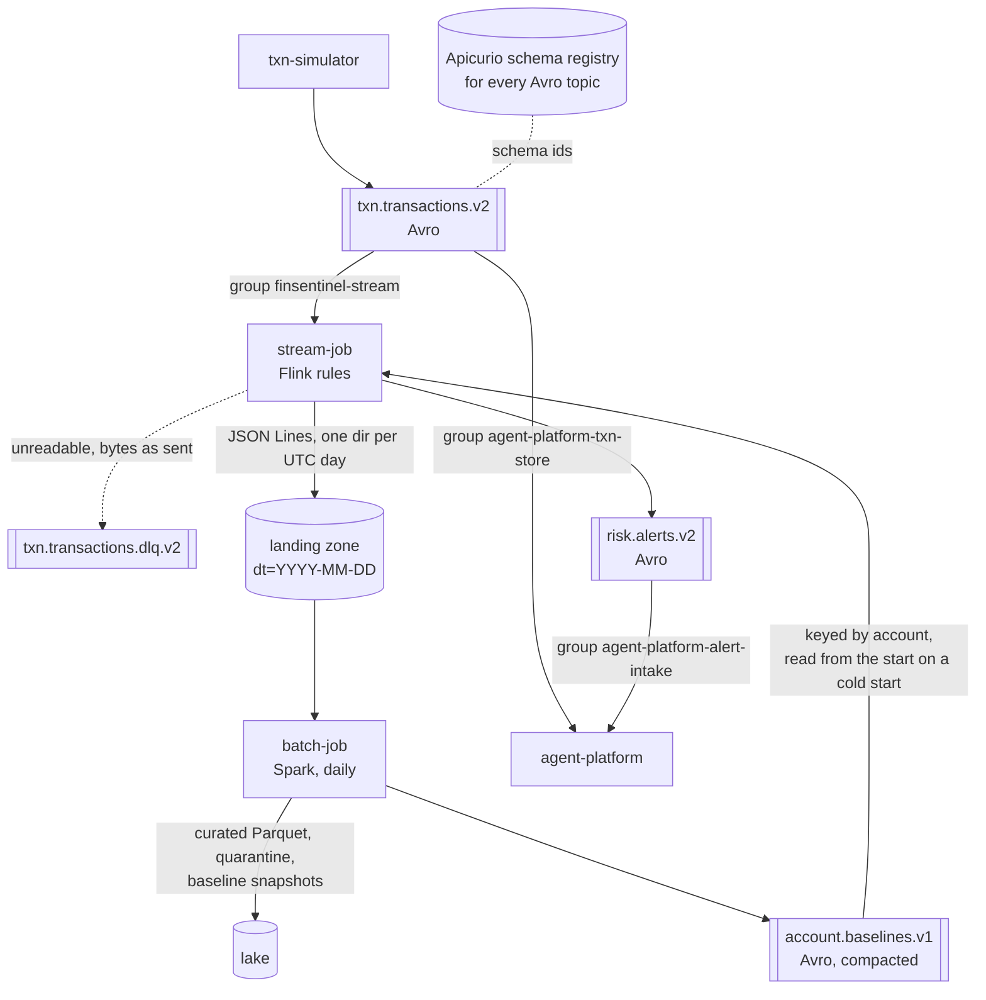
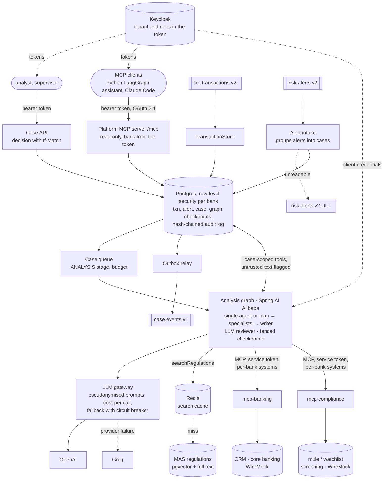
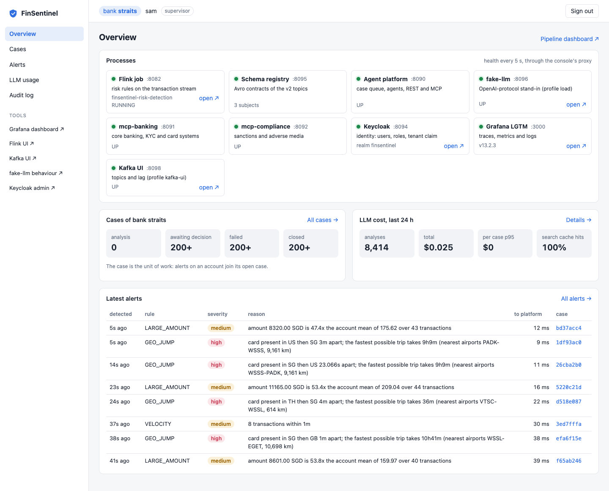
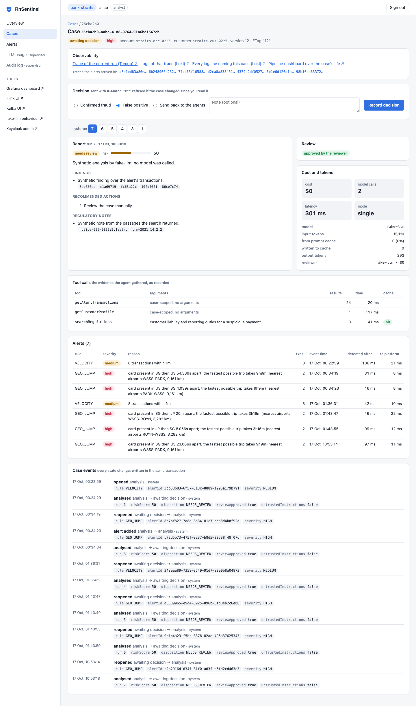
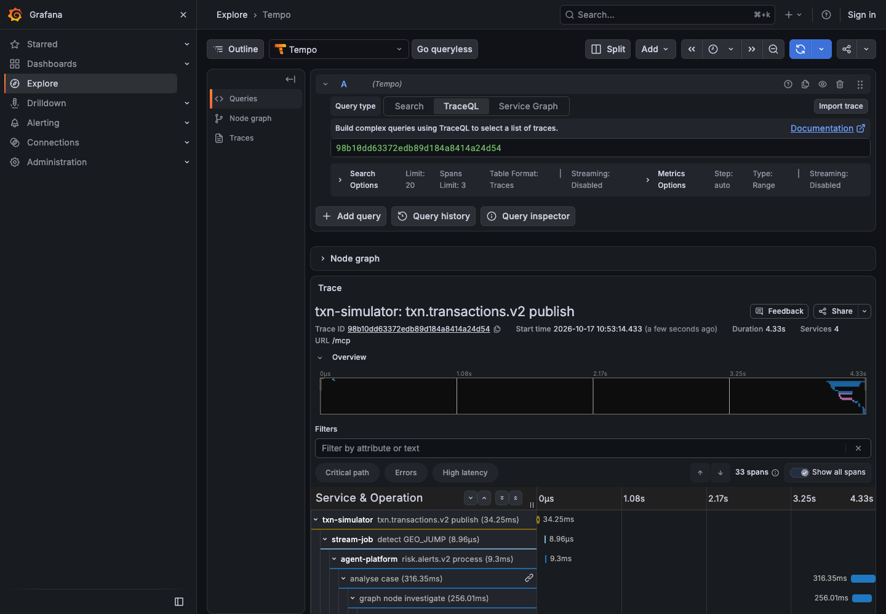
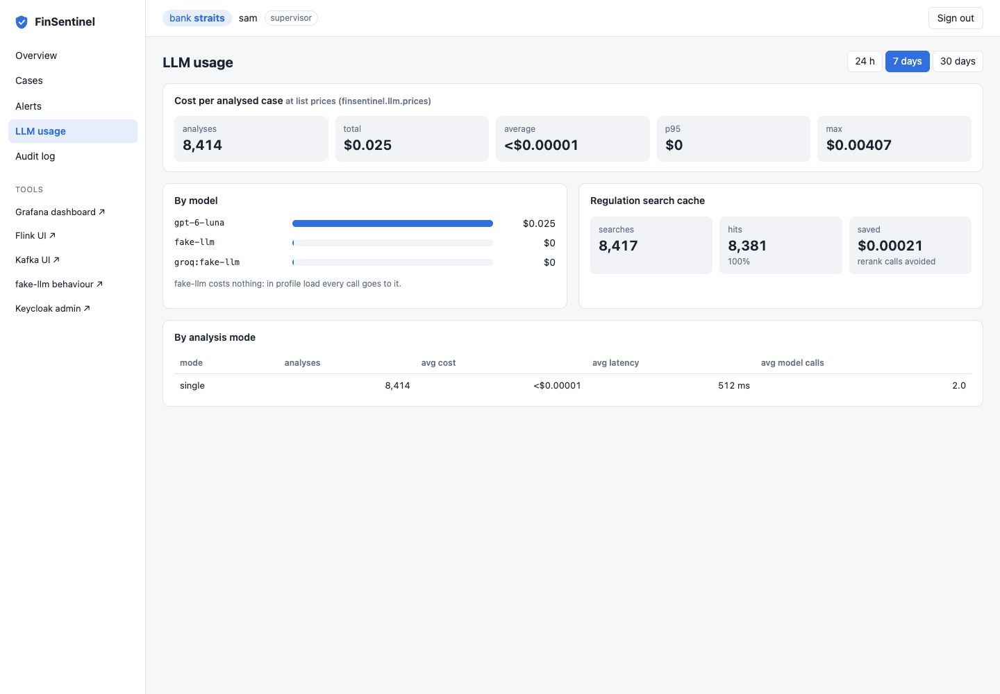

# FinSentinel

Real-time transaction risk detection for banks, with AI agents that investigate each alert and draft a case
report for a compliance analyst.

Built as a portfolio project covering the delivery work of a client-facing AI agent engineer: streaming data,
agent orchestration, RAG, MCP integration with enterprise systems, evaluation, security, and multi-tenancy.

## Measured

Every number below was measured, on one laptop (8 cores, 16 GB, everything in Docker), with the run that produced it
linked. The weak ones are included.

| What | Result | How it was measured |
|---|---|---|
| Detection latency, payment to alert (p95) | 142 ms at 50 tps, 626 ms at 10,000 tps | Flink job, simulator traffic ([ADR 0025](docs/adr/0025-load-tests.md)) |
| Stream catch-up throughput | 80,000 transactions/s on average | 4 million queued transactions, bound by 6 Kafka partitions, not CPU (ADR 0025) |
| Agent quality, golden evaluation | 51/51 runs pass, tool selection 100% | 17 cases x 3 on gpt-6-luna ([report](docs/eval/2026-10-15-luna.md), [ADR 0023](docs/adr/0023-gpt-6-luna.md)) |
| Model cost per case | $0.0012 in the evaluation, $0.003 end to end | End to end: 23 live alerts, review and repairs included (ADR 0025) |
| Payment to report with a real model (p95) | **107 s** (analysis alone: 38 s) | 23 live alerts on gpt-6-luna, 8 workers; the model and queue rounds dominate, not detection (ADR 0025) |
| Prompt tokens read from the provider's cache | 59%; the reviewer's **0%** | 17 cases; the reviewer's prefix is under the 1,024-token minimum ([report](docs/eval/2026-10-16-prompt-cache.md), ADR 0023) |
| Regulation search, hit@5 / MRR | 0.94 / 0.91 | 32 questions over the MAS corpus, hybrid search and LLM rerank ([ADR 0007](docs/adr/0007-regulatory-rag.md), ADR 0023) |
| Prompt injection in a payee name | Model alone cleared the case in **11 of 15** first drafts; the guard blocked all 11 | A flagged case can never be cleared, whatever the model says ([ADR 0016](docs/adr/0016-injection-defenses-and-audit-log.md)) |
| Analyst API under load (p95) | 14-37 ms up to 385 requests/s; **fails at 500 visits/s** | Gatling; the audit log's per-bank chain lock and a 10-connection pool give out first (ADR 0025) |
| Shared budget across two instances | Held at exactly 511 of 511 per hour | Counted in Postgres, not in memory (ADR 0025) |
| Recovery from 12 injected faults | Nothing lost in 11; a **150 s Postgres outage dead-lettered 1 alert**, the platform **could not start while the schema registry was down**, **both models down for 2 min failed 7 cases**, **slow outside systems cost every call 5 s**, and the worker's batches took **5-7 min** to drain any stall; all fixed and the drills repeated (0 dead letters; down 14 s instead of 9 min; 0 failed; drains in 11-107 s, [fixes](docs/perf/2026-10-18-9c-fixes.md)) | One fault at a time under steady traffic, loss counted from Kafka offsets and the database ([ADR 0026](docs/adr/0026-chaos-drills.md), [results](docs/perf/2026-10-17-phase-9c.md)) |
| Flink TaskManager killed | Restored from its checkpoint, 38/38 fraud scenarios detected, one duplicate alert stored once | Compose cluster; the JobManager noticed after 34 s (ADR 0026) |
| Large amounts after a cold Flink restart | **36/76** detected in 12 min without batch baselines; 27/27 with them | Rule history lost with the process; the batch baseline stands in (ADR 0026) |
| Platform instance killed mid-analysis | Resumed from checkpoints, no duplicate report; the claimed cases taken over after 34 s (before the heartbeat: **5 min**) | Live runs renew their claims every 10 s, a claim not renewed for 30 s lapses ([fixes](docs/perf/2026-10-18-9c-fixes.md), ADR 0026) |

Load tests run the platform against `fake-llm`, a stand-in that speaks OpenAI's protocol, so they measure the platform,
not a model ([ADR 0024](docs/adr/0024-phase-9-measurement.md)); the real-model rows say so.

**Data path**: detection, the lake and the batch baselines.



**Agent platform** (Spring Boot 4.1): cases, the analysis graph, the systems it calls, and who may call it.



The transaction topic has two independent consumers. Flink does not write transactions to Postgres: a slow or
down database would back-pressure the detection job, and fraud detection must keep running when the platform's
database does not. Each consumer group can also be replayed on its own.

Transactions and alerts are Avro, with schemas in an Apicurio registry (Confluent-compatible API and wire format).
Schemas are registered on purpose, never by producers; every producer fails to start if its schema is not registered
(the platform, a consumer, starts without the registry and its listeners wait for it), and the registry refuses a change that cannot read earlier data (BACKWARD_TRANSITIVE). An unreadable message goes to
the DLQ/DLT as the bytes that arrived; anything else (a registry or database outage) is retried until it succeeds,
never dead-lettered (ADR 0018, 0026).

Flink also writes every readable transaction to a landing zone (JSON Lines by UTC event date). A daily Spark job
curates it into Parquet and computes each account's 90-day baseline with robust statistics (median and MAD, so past
fraud does not shift it), then publishes the baselines back to Flink. Until an account has enough streaming history
(a redeployed job, an account idle past the state TTL), the large-amount rule judges it against that baseline, and the
alert says so (ADR 0019).

**Status:** phases 1–6 of 9 done (data path, investigation agent, regulatory RAG, case orchestration and MCP, LLM
gateway, tenancy and security); phase 7 evaluation harness built (baseline pending); phase 8 done (Avro contracts and
schema registry, Spark baselines, end-to-end tracing). See [docs/roadmap.md](docs/roadmap.md).

## Stack

Java 21 · Spring Boot 4.1 · Spring AI 2.0 · Kafka 4.2 · Flink 2.2 · Spark 4.2 · Postgres 17 + pgvector ·
Redis · Keycloak · OpenTelemetry / Grafana LGTM · Testcontainers · React 19 + Vite (console)

## Modules

| Module | What it is |
|---|---|
| `common` | Event records (`Transaction`, `Alert`). No dependencies. |
| `telemetry` | OpenTelemetry for the plain-Java processes (simulator, Flink): OTLP/HTTP export and the `traceparent` Kafka header. No Spring. |
| `contracts` | Kafka message contracts: Avro schemas, generated classes, mappers to the common records, a small serde for the Confluent wire format, and `SchemaRegistration`. No Spring. |
| `txn-simulator` | Traffic for two fictional banks (`harbour`, `straits`), with a week of backfill and injected fraud. |
| `stream-job` | Flink job. Velocity, large-amount (per-account baseline, streaming or from the batch job), and geo-jump rules (impossible travel: a lower bound from the nearest airports, ADR 0021). Pure-Java `RuleEngine`. Writes the landing zone. |
| `batch-job` | Daily Spark job: landing zone to curated Parquet, per-account robust baselines, published to Kafka for the stream job. No Spring. |
| `agent-platform` | Spring Boot modular monolith. Idempotent alert intake, transaction store, Postgres work queue, a case lifecycle around a Spring AI Alibaba analysis graph with fenced Postgres checkpoints, an investigator agent with case-scoped tools and per-rule playbooks, validated case reports, and a regulatory knowledge base (MAS documents, hybrid retrieval with rerank). |
| `mcp-banking` | MCP server for the bank's own systems: CRM profile (KYC, travel notices, staff notes) and core-banking security events. Stateless. |
| `mcp-compliance` | MCP server for the screening vendor: counterparty watchlists, including the inter-bank mule account list. Stateless. |
| `fake-llm` | OpenAI-compatible stand-in for load tests and drills: speaks the tool-calling protocol, answers any structured-output schema, injects latency and errors per provider (ADR 0024). No Spring. |
| `load-test` | Gatling simulations of the analyst case API and the MCP endpoint, with realm tokens (ADR 0025). Compiled by the build, run by hand. No Spring. |
| `console/` | Web console (React, Vite, TypeScript): case queue and case detail, alerts, LLM cost, audit log, the health of every process, and links from a case to its trace and logs. Signs in with Keycloak (PKCE); not part of the Maven build (ADR 0027). |
| `examples/mcp-client-python` | A LangGraph analyst assistant in Python that uses the platform only through its MCP server. |
| `deploy/systems/` | WireMock stand-ins for those systems, with id-pattern stories (travel notice, account takeover, mule payee, a prompt-injected CRM note). |
| `knowledge/` | `sources.json` lists the MAS documents; `scripts/fetch-knowledge.sh` downloads them (not committed). |

## Quick start

Needs Docker, JDK 21, and `OPENAI_API_KEY` in the environment (the platform starts without it, but
investigations fail). Maven comes from the wrapper.

```bash
# 1. Kafka, Postgres, Redis, Keycloak on :8094, the schema registry on :8095 (~2.5 GB), and the fake bank systems
docker compose -f deploy/docker-compose.yml --profile core --profile systems up -d

# 2. Build, register the message schemas (once; idempotent), and fetch the MAS documents for the knowledge base
./mvnw install -DskipTests
./mvnw -pl contracts exec:java
./scripts/fetch-knowledge.sh

# 3. MCP servers on :8091 and :8092 (optional: without them agents report those checks as not done), platform on :8090
java -jar mcp-banking/target/mcp-banking-0.1.0-SNAPSHOT.jar &
java -jar mcp-compliance/target/mcp-compliance-0.1.0-SNAPSHOT.jar &
java -jar agent-platform/target/agent-platform-0.1.0-SNAPSHOT.jar

# 4. Flink job in an embedded MiniCluster (web UI on :8082); override rules with -Djob.args
./mvnw -pl stream-job exec:exec

# 5. Traffic: 10 tps, one fraud scenario every 10 s
./mvnw -pl txn-simulator exec:java -Dexec.args="--fraud-every=10"

# 6. Once a day (any time; re-running is safe): curate the landing zone and publish account baselines.
#    The lake is ~/.finsentinel/lake by default (FINSENTINEL_LAKE_DIR for both jobs).
./mvnw -pl batch-job exec:exec -Djob.args="--as-of=$(date -u +%F)"

# 7. Sign in as alice (straits analyst; dev-only password grant), see the queue, then one case with its alerts,
#    analyses and audit trail. Other users: bob (harbour analyst), sam (straits supervisor), password = name.
TOKEN=$(curl -s localhost:8094/realms/finsentinel/protocol/openid-connect/token \
  -d grant_type=password -d client_id=analyst-cli -d username=alice -d password=alice | jq -r .access_token)
curl -s -H "Authorization: Bearer $TOKEN" 'localhost:8090/api/tenants/straits/cases?stage=AWAITING_DECISION' | jq
curl -s -H "Authorization: Bearer $TOKEN" localhost:8090/api/tenants/straits/cases/<caseId> | jq
```

### Console

A web console over the same API (ADR 0027): sign in through Keycloak (authorization code with PKCE, client
`finsentinel-console`), and the tenant and roles come from your token. Analysts see their bank's queue, each case with
its report, evidence, tool calls, review, cost, alerts and events, and decide with `If-Match` (a 409 says the case
changed since you read it). Supervisors also see LLM cost and the audit log with its hash-chain check. The overview
shows the health of every process; a case links to its trace in Tempo, its log lines in Loki and the pipeline
dashboard over its life.

```bash
scripts/stack.sh up                                   # the stack, profile load: fake-llm, traces and logs to Grafana
OTEL_EXPORTER_OTLP_ENDPOINT=http://localhost:4318 scripts/stack.sh flink       # another terminal; traced detection
scripts/stack.sh traffic --tps=10 --fraud-every=3 --otlp=http://localhost:4318  # another terminal; traced payments
scripts/stack.sh console                              # http://localhost:8097 (Node 22.22+); alice, bob or sam
docker compose -f deploy/docker-compose.yml --profile core --profile kafka-ui up -d kafka-ui   # optional, :8098
cd console && npm test && npm run screenshots         # unit tests; screenshots of every page into docs/console/
```

The browser talks to the console's own origin only: Vite proxies `/api/` to the platform and one health URL per
process, so the platform needs no CORS rule. Logs go to Loki only in profile `load`, where every account is simulated.

| Overview (supervisor) | Case detail (analyst) |
|---|---|
|  |  |
| **A case's trace in Tempo**: simulator, Flink, platform, graph nodes, MCP | **LLM usage** |
|  |  |

More in [docs/console/](docs/console/): queue, alerts, audit log, Loki, the analyst's view of a supervisor page.

### Case API

| Method | Path | Purpose |
|---|---|---|
| GET | `/api/tenants/{t}/cases?stage=AWAITING_DECISION` | Analyst queue, highest priority first |
| GET | `/api/tenants/{t}/cases/{id}` | Case, alerts, every analysis run, audit trail; `ETag` = case version |
| POST | `/api/tenants/{t}/cases/{id}/decision` | `{"decision": "CONFIRMED_FRAUD" \| "FALSE_POSITIVE" \| "REQUEST_REANALYSIS", "note": "..."}` with `If-Match` (428 if missing, 409 if the case changed); the deciding analyst is the token's user |

Every request needs a bearer token from the Keycloak realm `finsentinel` (deploy/keycloak) with this platform as
audience. The token's `tenant` claim must match the path (another bank's path is 404, like a case that does not exist);
roles: `analyst` reads and decides, `supervisor` reads and sees `llm-usage`, `assistant` uses MCP only. Anything not
listed is denied (ADR 0014). Underneath, Postgres row-level security holds every tenant table to the request's bank
(the platform logs in as `finsentinel_app`, not the schema owner); each bank's agents get only the tools of the systems
it has connected (`finsentinel.systems.connected`); phone numbers, emails, NRIC and card numbers reach the model as
per-case pseudonyms (ADR 0015). Text from outside the platform that tries to instruct the agents is flagged by rule:
the model gets it marked, such a case cannot be cleared, and the case records it; every request, allowed or refused,
goes into a per-bank hash-chained audit log (`GET /api/tenants/{t}/audit`, `.../audit/verify` for supervisors;
ADR 0016).

Lifecycle: `ANALYSIS → AWAITING_DECISION → CLOSED` (or `FAILED` after the maximum attempts, which are spread over
minutes by a growing pause, so a model outage of a few minutes does not use them up). A new alert on the account
re-opens the case; `REQUEST_REANALYSIS` sends it back to the agents with the analyst's note. Decisions and readiness are
published to `case.events.v1` through a transactional outbox.

Inside ANALYSIS a Spring AI Alibaba graph runs the agents (`finsentinel.analysis.mode`: `SINGLE`, one investigator,
the default; or `MULTI`, deterministic plan, parallel specialists and a report writer, ADR 0010). In both, an LLM
reviewer checks the report against the author's evidence and can send it back once; its verdict is stored with the
analysis. The graph checkpoints after every node to `graph_checkpoint` (plain
JSON). If the platform dies mid-analysis, its claims lapse after `claim-lease` (live runs renew theirs every
`claim-heartbeat`), and the next worker to claim the case resumes after the last finished node; a worker whose claim
was taken can no longer write checkpoints.

### Tracing

One trace follows a payment from the simulator through Flink's detection, the alert's wait in the case queue, every
graph node, model call and tool call, into the MCP servers and the bank's systems they call (ADR 0020). Trace context
travels in a `traceparent` Kafka header, is stored with the alert and the case across the queue, and is passed to MCP
servers in the request header. Flink makes one span per alert, not per transaction. Traces carry ids, model names,
token counts and cost, never prompts, answers, tool arguments or customer identifiers.

```bash
docker compose -f deploy/docker-compose.yml --profile obs up -d     # Grafana (Tempo, Prometheus, Loki) on :3000
# Then start each process with the OTLP endpoint:
#   platform and MCP servers: --management.opentelemetry.tracing.export.otlp.endpoint=http://localhost:4318/v1/traces
#   Flink job:                -Djob.args="--tracing.otlp-endpoint=http://localhost:4318"
#   simulator:                --otlp=http://localhost:4318      (or OTEL_EXPORTER_OTLP_ENDPOINT for the last two)
```

Without an endpoint nothing is exported and nothing is logged; trace context is still passed on, so a traced
producer's trace continues downstream.

### Load tests and chaos drills

Phase 9 (ADR 0024) runs the platform against `fake-llm`, an OpenAI-compatible stand-in that speaks the tool-calling
protocol and answers any structured-output schema, so the real gateway, tools, validation, review and fallback run and
nothing costs money. Its latency and errors can be changed per provider while the stack runs.

```bash
scripts/stack.sh up                       # Docker (core, systems, obs), schemas, fake-llm, MCP servers, platform (profile load)
scripts/stack.sh flink                    # Flink job, embedded (another terminal)
scripts/stack.sh traffic --tps=20 --fraud-every=3 --duration=120
# Grafana http://localhost:3000, dashboard "FinSentinel pipeline": alert-to-report p50/p95 and p95 by stage, backlog,
# analyses per minute, model-call latency, fallback share. Slow the main model down, or make it fail:
curl -X POST 'localhost:8096/admin/behaviour?provider=openai' -d '{"latencyMs":1500,"errorStatus":503,"errorRate":0.3}'
curl -X DELETE localhost:8096/admin/behaviour
scripts/stack.sh down
```

Load tests (phase 9B, ADR 0025; results in `docs/perf/2026-10-16-phase-9b.md`) run against that stack:

```bash
scripts/stack.sh traffic --tps=1000 --fraud-every=1 --duration=120   # a stream step
scripts/perf/flink-rate.py --interval 10                             # Flink's rate, lag and busy time
scripts/stack.sh traffic --tps=20 --fraud-every=0 --burst=120 --duration=25   # 120 alerts at once, for the queue
./mvnw -pl load-test gatling:test -Dgatling.simulationClass=com.finsentinel.loadtest.AnalystApiSimulation \
  -Danalyst.users-per-second=50                                      # or McpSimulation; settings: load-test.properties
```

Chaos drills (phase 9C, ADR 0026; results in `docs/perf/2026-10-17-phase-9c.md`) inject one fault while traffic runs
and record what was lost, dead-lettered or failed and how long recovery took, with Grafana screenshots:

```bash
scripts/stack.sh traffic --tps=20 --fraud-every=3 > target/stack/traffic.log 2>&1 &   # steady traffic, its log read back
scripts/perf/drill.py run postgres-down --out docs/perf/9c/07b-postgres-down-150s --sim-log target/stack/traffic.log \
  --hold 150 --inject "docker stop finsentinel-postgres-1" --heal "docker start finsentinel-postgres-1"
```

### LLM cost

Every analysis records its cost at list prices (all model calls, reranking included), in total and by model.
`GET /api/tenants/{t}/llm-usage?days=7` reports analyses, total, average, p95 and max cost per case, cost by model,
and cost and latency by analysis mode. Each agent role has its own model (`finsentinel.llm.models`); transfer and HIGH
cases can be escalated to a stronger model (`finsentinel.llm.escalation`, off by default: ADR 0011). Every model call
goes through one gateway: when a provider fails (error, rate limit, out of credit) the call falls back to
`groq:openai/gpt-oss-120b` (needs `GROQ_API_KEY`), with a circuit breaker per provider (ADR 0012). Outside systems
(CRM, core banking, screening) have one each too: after three failed calls in a row their tools answer `Unavailable` at
once for 30 s instead of each waiting out a slow system (ADR 0026).

Regulation search results are cached in Redis by exact question (normalised case and spacing), keyed by corpus
version and search settings; the report shows the hit rate and what the hits saved. Not by embedding similarity: a
semantic cache was measured and rejected, because questions one word apart with different answers ("authorised" vs
"unauthorized" scam) embed at 0.95 cosine. Prompts put text shared by cases first, so the provider's prompt cache
serves about 80% of each case's first request (it served none when case data came first). See ADR 0013.

### Evaluation

`src/test/resources/eval/golden-cases.json` holds 17 golden cases (fraud, false positives, transfer scams, takeover,
injection, resilience, tenant permissions, privacy). `GoldenEvalTest` runs them through the real agents several times,
grades each run deterministically (verdict, risk range, required and forbidden tools, relevant regulations, flags,
missing checks, leaked personal data), optionally adds an LLM judge, writes `target/eval/report.md`, and fails when a
threshold in `eval/thresholds.json` is missed. It stops before its budget (`-Deval.maxCostUsd`, default $1). A dry run
with stub agents validates every case in each build for free. CI: `.github/workflows/ci.yml` on every push (no model
calls, see "Tests"); `eval.yml` by hand. ADR 0017.

### MCP server

The platform is also an MCP server at `http://localhost:8090/mcp` (streamable HTTP, stateless), read-only:
`listCases`, `getCase`, `searchRegulations`, `readRegulationPassages`. It follows the MCP authorization spec: a request
without a token gets 401 with `resource_metadata` pointing to `/.well-known/oauth-protected-resource/mcp`, which names
the Keycloak realm. Case tools take no bank parameter: the bank is the token's `tenant` claim, so a model driving the
client cannot ask for another bank's cases. The Python example signs in with client credentials
(`cd examples/mcp-client-python && uv run analyst_assistant.py "Which cases await a decision?"`); any MCP client that
sends a bearer token works, e.g. Claude Code with
`claude mcp add --transport http finsentinel http://localhost:8090/mcp --header "Authorization: Bearer $TOKEN"` (realm
tokens last 5 minutes). Regulation searches have their own hourly budget.

Investigations are capped at `finsentinel.investigation.max-per-hour` (default 60) so a burst of alerts cannot
run up an unbounded LLM bill. Set `finsentinel.investigation.enabled=false` to store alerts without investigating.

Simulator options: `--tps`, `--accounts` (per tenant), `--backfill` (history per account), `--fraud-every`
(seconds, 0 = off), `--burst` (scenarios on as many accounts at once after the backfill), `--duration` (seconds,
0 = forever), `--seed` (traffic only; random by default and printed at start). The account population is fixed per
account id, so the same id is always the same customer whatever `--accounts` is. Scenario transactions are published
at their event time (a velocity burst takes 18 s).

To run the Flink job from IntelliJ, enable "Add dependencies with provided scope to classpath" in the run
configuration and add the `--add-opens` flags from `stream-job/pom.xml` (`flink.jvm.opens`).

## Configuration

| What | Where | Override |
|---|---|---|
| Flink rules, state TTL, Kafka, schema registry, lake directory, checkpoint interval and directory | `stream-job/src/main/resources/stream-job.properties` | `--key=value` job arguments (`-Djob.args="..."` for local runs); unknown keys are rejected |
| Investigation queue, budget, tool limits, report rules | `agent-platform/src/main/resources/application.yaml` (`finsentinel.investigation.*`) | Spring Boot property sources (env, `--` args); invalid values fail at startup |
| Alert API and Kafka retry | same file (`finsentinel.alerts.*`) | same |
| Schema registry | same file (`finsentinel.schema-registry.*`); simulator `--registry=`; all three also read `SCHEMA_REGISTRY_URL` | same |
| Batch job: lake directory, as-of date, curation lookback, baseline window, publishing | `batch-job/src/main/resources/batch-job.properties` | `--key=value` (`-Djob.args="..."`); unknown keys are rejected |
| Message schemas | `contracts/src/main/avro/*.avsc`; compatibility rule in `Contracts` | register with `./mvnw -pl contracts exec:java [-Dexec.args=<url>]` |
| Model and API key | same file (`spring.ai.openai.*`) | `OPENAI_API_KEY` |
| Agent instructions | `agent-platform/src/main/resources/prompts/investigator-system.md`, plus one playbook per rule in `prompts/playbooks/` | |
| Knowledge base: documents, chunking, retrieval, rerank | `knowledge/sources.json`; `finsentinel.knowledge.*` in `application.yaml` | same as above |
| Simulator | command-line arguments | |

## Ports

| Service | Port |
|---|---|
| Kafka | 9092 |
| Postgres | 5432 |
| Redis | 6380 |
| agent-platform (REST and `/mcp`) | 8090 |
| mcp-banking, mcp-compliance | 8091, 8092 |
| Fake bank systems (WireMock) | 8093 |
| Keycloak | 8094 |
| Schema registry (Apicurio) | 8095 |
| fake-llm (profile `load`) | 8096 |
| Web console (`scripts/stack.sh console`) | 8097 |
| Kafka UI (`kafka-ui` profile) | 8098 |
| Grafana (`obs` profile), OTLP gRPC / HTTP | 3000, 4317 / 4318 |
| Flink UI (local run) | 8082 |
| Flink UI (`stream` profile) | 8081 |

## Tests

```bash
./mvnw test   # Docker must be running: platform tests use Testcontainers. No LLM calls.

# Real-model checks (cost money, not deterministic; run several times)
./mvnw -pl agent-platform test -Dtest=LiveInvestigationTest -Dlive=true -Dsurefire.failIfNoSpecifiedTests=false

# Retrieval evaluation: hit@5 and MRR for vector, keyword, hybrid, hybrid+rerank (needs fetched documents)
./mvnw -pl agent-platform test -Dtest=RetrievalEvalTest -Dlive=true -Dsurefire.failIfNoSpecifiedTests=false
```

`verify` also runs the static checks: javac lint and Error Prone (warnings fail the build), Maven Enforcer
(Spring-free and dependency-free modules, pinned plugin versions) and ArchUnit checks of the architecture rules (`ArchitectureTest`).
CI (`.github/workflows/ci.yml`, ADR 0022) adds a CycloneDX SBOM, a Trivy scan of it for known vulnerabilities
(exceptions, dated, in `.trivyignore.yaml`), a Trivy scan of the repository for secrets, and actionlint; Dependabot
proposes updates weekly.

## Design decisions


- [0001 Modular monolith, Spring-free jobs](docs/adr/0001-modular-monolith.md)
- [0002 MCP vs in-process tools](docs/adr/0002-mcp-vs-in-process-tools.md)
- [0003 At-least-once alerts, idempotent consumer](docs/adr/0003-at-least-once-alerts.md)
- [0004 Investigation queue, fencing, spend circuit breaker](docs/adr/0004-investigation-queue.md)
- [0005 SQL-first persistence with JdbcClient](docs/adr/0005-sql-first-persistence.md)
- [0006 Agent tools scoped by construction; validated, repaired output](docs/adr/0006-agent-tools-and-output.md)
- [0007 Regulatory RAG: chunking, hybrid retrieval, rerank, playbooks](docs/adr/0007-regulatory-rag.md)
- [0008 Case orchestration in two layers](docs/adr/0008-case-orchestration.md)
- [0009 Graph runtime: Spring AI Alibaba Graph](docs/adr/0009-graph-runtime-spring-ai-alibaba.md)
- [0010 Multi-agent analysis, measured against a single agent](docs/adr/0010-multi-agent-analysis.md)
- [0011 Model per role, escalation, cost per case](docs/adr/0011-model-routing-and-cost.md)
- [0012 One LLM gateway, provider fallback, circuit breaking](docs/adr/0012-provider-fallback.md)
- [0013 Caching: exact-match search cache, no semantic cache](docs/adr/0013-caching.md)
- [0014 Identity and access: Keycloak, tenant from the token](docs/adr/0014-identity-and-access.md)
- [0015 Row-level security, per-bank tools, pseudonymised prompts](docs/adr/0015-tenant-isolation-and-data-protection.md)
- [0016 Injection defenses and a tamper-evident audit log](docs/adr/0016-injection-defenses-and-audit-log.md)
- [0017 Evaluation harness](docs/adr/0017-evaluation-harness.md)
- [0018 Avro contracts in a schema registry](docs/adr/0018-avro-contracts-and-schema-registry.md)
- [0019 Daily Spark baselines over a Flink landing zone](docs/adr/0019-batch-baselines.md)
- [0020 One trace from the payment to the bank's systems](docs/adr/0020-end-to-end-tracing.md)
- [0021 Geo-velocity: a lower bound on travel between countries](docs/adr/0021-travel-feasibility.md)
- [0022 CI quality and security gates](docs/adr/0022-ci-quality-and-security-gates.md)
- [0023 GPT-6 Luna as the default model](docs/adr/0023-gpt-6-luna.md)
- [0024 Phase 9 foundation: fake LLM, pipeline metrics, stack script](docs/adr/0024-phase-9-measurement.md)
- [0025 Load tests: Gatling for the APIs, the simulator for the stream](docs/adr/0025-load-tests.md)
- [0026 Chaos drills under steady traffic](docs/adr/0026-chaos-drills.md)
- [0027 A web console over the tenant-scoped API, signed in with PKCE](docs/adr/0027-web-console.md)
