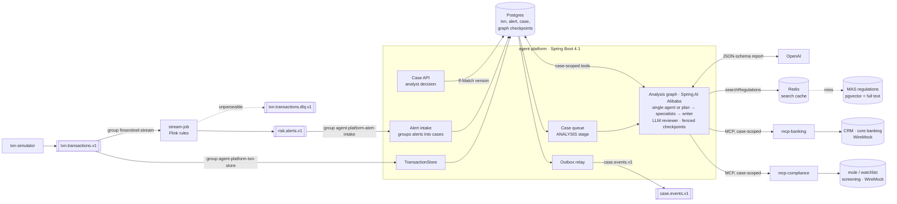

# FinSentinel

Real-time transaction risk detection for banks, with AI agents that investigate each alert and draft a case
report for a compliance analyst.

Built as a portfolio project covering the delivery work of a client-facing AI agent engineer: streaming data,
agent orchestration, RAG, MCP integration with enterprise systems, evaluation, security, and multi-tenancy.



The transaction topic has two independent consumers. Flink does not write transactions to Postgres: a slow or
down database would back-pressure the detection job, and fraud detection must keep running when the platform's
database does not. Each consumer group can also be replayed on its own.

**Status:** phases 1–3 of 9 done (data path, investigation agent, regulatory RAG); phases 1–4 done, phase 5 done (model per role, cost per case, provider fallback, caching). Phase 4: case lifecycle, checkpointed and resumable analysis graph, bank systems over MCP, multi-agent analysis with a reviewer, and the platform as an MCP server. See [docs/roadmap.md](docs/roadmap.md).

## Stack

Java 21 · Spring Boot 4.1 · Spring AI 2.0 · Kafka 4.2 · Flink 2.2 · Spark 4.2 · Postgres 17 + pgvector ·
Redis · Keycloak · OpenTelemetry / Grafana LGTM · Testcontainers

## Modules

| Module | What it is |
|---|---|
| `common` | Event records (`Transaction`, `Alert`). No dependencies. |
| `txn-simulator` | Traffic for two fictional banks (`harbour`, `straits`), with a week of backfill and injected fraud. |
| `stream-job` | Flink job. Velocity, large-amount (per-account baseline), and geo-jump rules. Pure-Java `RuleEngine`. |
| `agent-platform` | Spring Boot modular monolith. Idempotent alert intake, transaction store, Postgres work queue, a case lifecycle around a Spring AI Alibaba analysis graph with fenced Postgres checkpoints, an investigator agent with case-scoped tools and per-rule playbooks, validated case reports, and a regulatory knowledge base (MAS documents, hybrid retrieval with rerank). |
| `mcp-banking` | MCP server for the bank's own systems: CRM profile (KYC, travel notices, staff notes) and core-banking security events. Stateless. |
| `mcp-compliance` | MCP server for the screening vendor: counterparty watchlists, including the inter-bank mule account list. Stateless. |
| `examples/mcp-client-python` | A LangGraph analyst assistant in Python that uses the platform only through its MCP server. |
| `deploy/systems/` | WireMock stand-ins for those systems, with id-pattern stories (travel notice, account takeover, mule payee, a prompt-injected CRM note). |
| `knowledge/` | `sources.json` lists the MAS documents; `scripts/fetch-knowledge.sh` downloads them (not committed). |

## Quick start

Needs Docker, JDK 21, and `OPENAI_API_KEY` in the environment (the platform starts without it, but
investigations fail). Maven comes from the wrapper.

```bash
# 1. Kafka, Postgres, Redis, Keycloak on :8094 (~2 GB), and the fake bank systems
docker compose -f deploy/docker-compose.yml --profile core --profile systems up -d

# 2. Build, and fetch the MAS documents for the knowledge base (indexed on platform start)
./mvnw install -DskipTests
./scripts/fetch-knowledge.sh

# 3. MCP servers on :8091 and :8092 (optional: without them agents report those checks as not done), platform on :8090
java -jar mcp-banking/target/mcp-banking-0.1.0-SNAPSHOT.jar &
java -jar mcp-compliance/target/mcp-compliance-0.1.0-SNAPSHOT.jar &
java -jar agent-platform/target/agent-platform-0.1.0-SNAPSHOT.jar

# 4. Flink job in an embedded MiniCluster (web UI on :8082); override rules with -Djob.args
./mvnw -pl stream-job exec:exec

# 5. Traffic: 10 tps, one fraud scenario every 10 s
./mvnw -pl txn-simulator exec:java -Dexec.args="--fraud-every=10"

# 6. Sign in as alice (straits analyst; dev-only password grant), see the queue, then one case with its alerts,
#    analyses and audit trail. Other users: bob (harbour analyst), sam (straits supervisor), password = name.
TOKEN=$(curl -s localhost:8094/realms/finsentinel/protocol/openid-connect/token \
  -d grant_type=password -d client_id=analyst-cli -d username=alice -d password=alice | jq -r .access_token)
curl -s -H "Authorization: Bearer $TOKEN" 'localhost:8090/api/tenants/straits/cases?stage=AWAITING_DECISION' | jq
curl -s -H "Authorization: Bearer $TOKEN" localhost:8090/api/tenants/straits/cases/<caseId> | jq
```

### Case API

| Method | Path | Purpose |
|---|---|---|
| GET | `/api/tenants/{t}/cases?stage=AWAITING_DECISION` | Analyst queue, highest priority first |
| GET | `/api/tenants/{t}/cases/{id}` | Case, alerts, every analysis run, audit trail; `ETag` = case version |
| POST | `/api/tenants/{t}/cases/{id}/decision` | `{"decision": "CONFIRMED_FRAUD" \| "FALSE_POSITIVE" \| "REQUEST_REANALYSIS", "note": "..."}` with `If-Match` (428 if missing, 409 if the case changed); the deciding analyst is the token's user |

Every request needs a bearer token from the Keycloak realm `finsentinel` (deploy/keycloak) with this platform as
audience. The token's `tenant` claim must match the path (another bank's path is 404, like a case that does not exist);
roles: `analyst` reads and decides, `supervisor` reads and sees `llm-usage`, `assistant` uses MCP only. Anything not
listed is denied (ADR 0014). Underneath, Postgres row-level security holds every tenant table to the request's bank
(the platform logs in as `finsentinel_app`, not the schema owner); each bank's agents get only the tools of the systems
it has connected (`finsentinel.systems.connected`); phone numbers, emails, NRIC and card numbers reach the model as
per-case pseudonyms (ADR 0015).

Lifecycle: `ANALYSIS → AWAITING_DECISION → CLOSED` (or `FAILED` after the maximum attempts). A new alert on the account
re-opens the case; `REQUEST_REANALYSIS` sends it back to the agents with the analyst's note. Decisions and readiness are
published to `case.events.v1` through a transactional outbox.

Inside ANALYSIS a Spring AI Alibaba graph runs the agents (`finsentinel.analysis.mode`: `SINGLE`, one investigator,
the default; or `MULTI`, deterministic plan, parallel specialists and a report writer, ADR 0010). In both, an LLM
reviewer checks the report against the author's evidence and can send it back once; its verdict is stored with the
analysis. The graph checkpoints after every node to `graph_checkpoint` (plain
JSON). If the platform dies mid-analysis, the next worker to claim the case (after `claim-timeout`) resumes after the
last finished node; a worker whose claim has timed out can no longer write checkpoints.

### LLM cost

Every analysis records its cost at list prices (all model calls, reranking included), in total and by model.
`GET /api/tenants/{t}/llm-usage?days=7` reports analyses, total, average, p95 and max cost per case, cost by model,
and cost and latency by analysis mode. Each agent role has its own model (`finsentinel.llm.models`); transfer and HIGH
cases can be escalated to a stronger model (`finsentinel.llm.escalation`, off by default: ADR 0011). Every model call
goes through one gateway: when a provider fails (error, rate limit, out of credit) the call falls back to
`groq:openai/gpt-oss-120b` (needs `GROQ_API_KEY`), with a circuit breaker per provider (ADR 0012).

Regulation search results are cached in Redis by exact question (normalised case and spacing), keyed by corpus
version and search settings; the report shows the hit rate and what the hits saved. Not by embedding similarity: a
semantic cache was measured and rejected, because questions one word apart with different answers ("authorised" vs
"unauthorized" scam) embed at 0.95 cosine. Prompts put text shared by cases first, so the provider's prompt cache
serves about 80% of each case's first request (it served none when case data came first). See ADR 0013.

### MCP server

The platform is also an MCP server at `http://localhost:8090/mcp` (streamable HTTP, stateless), read-only:
`listCases`, `getCase`, `searchRegulations`, `readRegulationPassages`. It follows the MCP authorization spec: a request
without a token gets 401 with `resource_metadata` pointing to `/.well-known/oauth-protected-resource/mcp`, which names
the Keycloak realm. Case tools take no bank parameter: the bank is the token's `tenant` claim, so a model driving the
client cannot ask for another bank's cases. The Python example signs in with client credentials
(`cd examples/mcp-client-python && uv run analyst_assistant.py "Which cases await a decision?"`); any MCP client that
sends a bearer token works, e.g. Claude Code with
`claude mcp add --transport http finsentinel http://localhost:8090/mcp --header "Authorization: Bearer $TOKEN"` (realm
tokens last 5 minutes). Regulation searches have their own hourly budget.

Investigations are capped at `finsentinel.investigation.max-per-hour` (default 60) so a burst of alerts cannot
run up an unbounded LLM bill. Set `finsentinel.investigation.enabled=false` to store alerts without investigating.

Simulator options: `--tps`, `--accounts` (per tenant), `--backfill` (history per account), `--fraud-every`
(seconds, 0 = off), `--duration` (seconds, 0 = forever), `--seed` (traffic only; random by default and printed at
start). The account population is fixed, so the same account id is always the same customer.

To run the Flink job from IntelliJ, enable "Add dependencies with provided scope to classpath" in the run
configuration and add the `--add-opens` flags from `stream-job/pom.xml` (`flink.jvm.opens`).

## Configuration

| What | Where | Override |
|---|---|---|
| Flink rules, state TTL, Kafka, checkpoints | `stream-job/src/main/resources/stream-job.properties` | `--key=value` job arguments (`-Djob.args="..."` for local runs); unknown keys are rejected |
| Investigation queue, budget, tool limits, report rules | `agent-platform/src/main/resources/application.yaml` (`finsentinel.investigation.*`) | Spring Boot property sources (env, `--` args); invalid values fail at startup |
| Alert API and Kafka retry | same file (`finsentinel.alerts.*`) | same |
| Model and API key | same file (`spring.ai.openai.*`) | `OPENAI_API_KEY` |
| Agent instructions | `agent-platform/src/main/resources/prompts/investigator-system.md`, plus one playbook per rule in `prompts/playbooks/` | |
| Knowledge base: documents, chunking, retrieval, rerank | `knowledge/sources.json`; `finsentinel.knowledge.*` in `application.yaml` | same as above |
| Simulator | command-line arguments | |

## Ports

| Service | Port |
|---|---|
| Kafka | 9092 |
| Postgres | 5432 |
| Redis | 6380 |
| agent-platform | 8090 |
| Flink UI (local run) | 8082 |
| Flink UI (`stream` profile) | 8081 |
| Grafana (`obs` profile) | 3000 |

## Tests

```bash
./mvnw test   # Docker must be running: platform tests use Testcontainers. No LLM calls.

# Real-model checks (cost money, not deterministic; run several times)
./mvnw -pl agent-platform test -Dtest=LiveInvestigationTest -Dlive=true -Dsurefire.failIfNoSpecifiedTests=false

# Retrieval evaluation: hit@5 and MRR for vector, keyword, hybrid, hybrid+rerank (needs fetched documents)
./mvnw -pl agent-platform test -Dtest=RetrievalEvalTest -Dlive=true -Dsurefire.failIfNoSpecifiedTests=false
```

## Design decisions

Study notes (Chinese): [docs/study-guide.md](docs/study-guide.md)


- [0001 Modular monolith, Spring-free jobs](docs/adr/0001-modular-monolith.md)
- [0002 MCP vs in-process tools](docs/adr/0002-mcp-vs-in-process-tools.md)
- [0003 At-least-once alerts, idempotent consumer](docs/adr/0003-at-least-once-alerts.md)
- [0004 Investigation queue, fencing, spend circuit breaker](docs/adr/0004-investigation-queue.md)
- [0005 SQL-first persistence with JdbcClient](docs/adr/0005-sql-first-persistence.md)
- [0006 Agent tools scoped by construction; validated, repaired output](docs/adr/0006-agent-tools-and-output.md)
- [0007 Regulatory RAG: chunking, hybrid retrieval, rerank, playbooks](docs/adr/0007-regulatory-rag.md)
