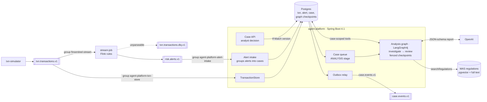

# FinSentinel

Real-time transaction risk detection for banks, with AI agents that investigate each alert and draft a case
report for a compliance analyst.

Built as a portfolio project covering the delivery work of a client-facing AI agent engineer: streaming data,
agent orchestration, RAG, MCP integration with enterprise systems, evaluation, security, and multi-tenancy.



The transaction topic has two independent consumers. Flink does not write transactions to Postgres: a slow or
down database would back-pressure the detection job, and fraud detection must keep running when the platform's
database does not. Each consumer group can also be replayed on its own.

**Status:** phases 1–3 of 9 done (data path, investigation agent, regulatory RAG); phase 4 steps A (case lifecycle) and B (checkpointed analysis graph) done. See [docs/roadmap.md](docs/roadmap.md).

## Stack

Java 21 · Spring Boot 4.1 · Spring AI 2.0 · Kafka 4.2 · Flink 2.2 · Spark 4.2 · Postgres 17 + pgvector ·
Redis · Keycloak · OpenTelemetry / Grafana LGTM · Testcontainers

## Modules

| Module | What it is |
|---|---|
| `common` | Event records (`Transaction`, `Alert`). No dependencies. |
| `txn-simulator` | Traffic for two fictional banks (`harbour`, `straits`), with a week of backfill and injected fraud. |
| `stream-job` | Flink job. Velocity, large-amount (per-account baseline), and geo-jump rules. Pure-Java `RuleEngine`. |
| `agent-platform` | Spring Boot modular monolith. Idempotent alert intake, transaction store, Postgres work queue, a case lifecycle around a LangGraph4j analysis graph with fenced Postgres checkpoints, an investigator agent with case-scoped tools and per-rule playbooks, validated case reports, and a regulatory knowledge base (MAS documents, hybrid retrieval with rerank). |
| `knowledge/` | `sources.json` lists the MAS documents; `scripts/fetch-knowledge.sh` downloads them (not committed). |

## Quick start

Needs Docker, JDK 21, and `OPENAI_API_KEY` in the environment (the platform starts without it, but
investigations fail). Maven comes from the wrapper.

```bash
# 1. Kafka, Postgres, Redis (~1.2 GB)
docker compose -f deploy/docker-compose.yml --profile core up -d

# 2. Build, and fetch the MAS documents for the knowledge base (indexed on platform start)
./mvnw install -DskipTests
./scripts/fetch-knowledge.sh

# 3. Platform on :8090
java -jar agent-platform/target/agent-platform-0.1.0-SNAPSHOT.jar

# 4. Flink job in an embedded MiniCluster (web UI on :8082); override rules with -Djob.args
./mvnw -pl stream-job exec:exec

# 5. Traffic: 10 tps, one fraud scenario every 10 s
./mvnw -pl txn-simulator exec:java -Dexec.args="--fraud-every=10"

# 6. See the analyst queue, then one case with its alerts, analyses and audit trail
curl -s 'localhost:8090/api/tenants/straits/cases?stage=AWAITING_DECISION' | jq
curl -s localhost:8090/api/tenants/straits/cases/<caseId> | jq
```

### Case API

| Method | Path | Purpose |
|---|---|---|
| GET | `/api/tenants/{t}/cases?stage=AWAITING_DECISION` | Analyst queue, highest priority first |
| GET | `/api/tenants/{t}/cases/{id}` | Case, alerts, every analysis run, audit trail; `ETag` = case version |
| POST | `/api/tenants/{t}/cases/{id}/decision` | `{"decision": "CONFIRMED_FRAUD" \| "FALSE_POSITIVE" \| "REQUEST_REANALYSIS", "note": "..."}` with `If-Match` (428 if missing, 409 if the case changed) and `X-Analyst-Id` |

Lifecycle: `ANALYSIS → AWAITING_DECISION → CLOSED` (or `FAILED` after the maximum attempts). A new alert on the account
re-opens the case; `REQUEST_REANALYSIS` sends it back to the agents with the analyst's note. Decisions and readiness are
published to `case.events.v1` through a transactional outbox.

Inside ANALYSIS a LangGraph4j graph runs the agents and checkpoints after every node to `graph_checkpoint` (plain
JSON). If the platform dies mid-analysis, the next worker to claim the case (after `claim-timeout`) resumes after the
last finished node; a worker whose claim has timed out can no longer write checkpoints.

Investigations are capped at `finsentinel.investigation.max-per-hour` (default 60) so a burst of alerts cannot
run up an unbounded LLM bill. Set `finsentinel.investigation.enabled=false` to store alerts without investigating.

Simulator options: `--tps`, `--accounts` (per tenant), `--backfill` (history per account), `--fraud-every`
(seconds, 0 = off), `--duration` (seconds, 0 = forever), `--seed` (traffic only; random by default and printed at
start). The account population is fixed, so the same account id is always the same customer.

To run the Flink job from IntelliJ, enable "Add dependencies with provided scope to classpath" in the run
configuration and add the `--add-opens` flags from `stream-job/pom.xml` (`flink.jvm.opens`).

## Configuration

| What | Where | Override |
|---|---|---|
| Flink rules, state TTL, Kafka, checkpoints | `stream-job/src/main/resources/stream-job.properties` | `--key=value` job arguments (`-Djob.args="..."` for local runs); unknown keys are rejected |
| Investigation queue, budget, tool limits, report rules | `agent-platform/src/main/resources/application.yaml` (`finsentinel.investigation.*`) | Spring Boot property sources (env, `--` args); invalid values fail at startup |
| Alert API and Kafka retry | same file (`finsentinel.alerts.*`) | same |
| Model and API key | same file (`spring.ai.openai.*`) | `OPENAI_API_KEY` |
| Agent instructions | `agent-platform/src/main/resources/prompts/investigator-system.md`, plus one playbook per rule in `prompts/playbooks/` | |
| Knowledge base: documents, chunking, retrieval, rerank | `knowledge/sources.json`; `finsentinel.knowledge.*` in `application.yaml` | same as above |
| Simulator | command-line arguments | |

## Ports

| Service | Port |
|---|---|
| Kafka | 9092 |
| Postgres | 5432 |
| Redis | 6380 |
| agent-platform | 8090 |
| Flink UI (local run) | 8082 |
| Flink UI (`stream` profile) | 8081 |
| Grafana (`obs` profile) | 3000 |

## Tests

```bash
./mvnw test   # Docker must be running: platform tests use Testcontainers. No LLM calls.

# Real-model checks (cost money, not deterministic; run several times)
./mvnw -pl agent-platform test -Dtest=LiveInvestigationTest -Dlive=true -Dsurefire.failIfNoSpecifiedTests=false

# Retrieval evaluation: hit@5 and MRR for vector, keyword, hybrid, hybrid+rerank (needs fetched documents)
./mvnw -pl agent-platform test -Dtest=RetrievalEvalTest -Dlive=true -Dsurefire.failIfNoSpecifiedTests=false
```

## Design decisions

Study notes (Chinese): [docs/study-guide.md](docs/study-guide.md)


- [0001 Modular monolith, Spring-free jobs](docs/adr/0001-modular-monolith.md)
- [0002 MCP vs in-process tools](docs/adr/0002-mcp-vs-in-process-tools.md)
- [0003 At-least-once alerts, idempotent consumer](docs/adr/0003-at-least-once-alerts.md)
- [0004 Investigation queue, fencing, spend circuit breaker](docs/adr/0004-investigation-queue.md)
- [0005 SQL-first persistence with JdbcClient](docs/adr/0005-sql-first-persistence.md)
- [0006 Agent tools scoped by construction; validated, repaired output](docs/adr/0006-agent-tools-and-output.md)
- [0007 Regulatory RAG: chunking, hybrid retrieval, rerank, playbooks](docs/adr/0007-regulatory-rag.md)
