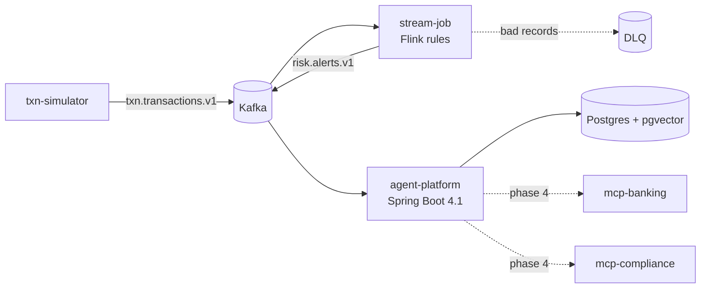

# FinSentinel

Real-time transaction risk detection for banks, with AI agents that investigate each alert and draft a case
report for a compliance analyst.

Built as a portfolio project covering the delivery work of a client-facing AI agent engineer: streaming data,
agent orchestration, RAG, MCP integration with enterprise systems, evaluation, security, and multi-tenancy.



**Status:** phase 1 of 9 done (data path). See [docs/roadmap.md](docs/roadmap.md).

## Stack

Java 21 · Spring Boot 4.1 · Spring AI 2.0 · Kafka 4.2 · Flink 2.2 · Spark 4.2 · Postgres 17 + pgvector ·
Redis · Keycloak · OpenTelemetry / Grafana LGTM · Testcontainers

## Modules

| Module | What it is |
|---|---|
| `common` | Event records (`Transaction`, `Alert`). No dependencies. |
| `txn-simulator` | Traffic for two fictional banks (`harbour`, `straits`), with a week of backfill and injected fraud. |
| `stream-job` | Flink job. Velocity, large-amount (per-account baseline), and geo-jump rules. Pure-Java `RuleEngine`. |
| `agent-platform` | Spring Boot modular monolith. Today: idempotent alert intake and a tenant-scoped alerts API. |

## Quick start

Needs Docker and JDK 21. Maven comes from the wrapper.

```bash
# 1. Kafka, Postgres, Redis (~1.2 GB)
docker compose -f deploy/docker-compose.yml --profile core up -d

# 2. Build
./mvnw install -DskipTests

# 3. Platform on :8090
java -jar agent-platform/target/agent-platform-0.1.0-SNAPSHOT.jar

# 4. Flink job in an embedded MiniCluster (web UI on :8082)
./mvnw -pl stream-job exec:exec

# 5. Traffic: 10 tps, one fraud scenario every 10 s
./mvnw -pl txn-simulator exec:java -Dexec.args="--fraud-every=10"

# 6. See alerts
curl -s localhost:8090/api/tenants/straits/alerts | jq
```

Simulator options: `--tps`, `--accounts` (per tenant), `--backfill` (history per account), `--fraud-every`
(seconds, 0 = off), `--duration` (seconds, 0 = forever), `--seed`.

To run the Flink job from IntelliJ, enable "Add dependencies with provided scope to classpath" in the run
configuration and add the `--add-opens` flags from `stream-job/pom.xml` (`flink.jvm.opens`).

## Ports

| Service | Port |
|---|---|
| Kafka | 9092 |
| Postgres | 5432 |
| Redis | 6380 |
| agent-platform | 8090 |
| Flink UI (local run) | 8082 |
| Flink UI (`stream` profile) | 8081 |
| Grafana (`obs` profile) | 3000 |

## Tests

```bash
./mvnw test   # Docker must be running: platform tests use Testcontainers
```

## Design decisions

Study notes (Chinese): [docs/study-guide.md](docs/study-guide.md)


- [0001 Modular monolith, Spring-free jobs](docs/adr/0001-modular-monolith.md)
- [0002 MCP vs in-process tools](docs/adr/0002-mcp-vs-in-process-tools.md)
- [0003 At-least-once alerts, idempotent consumer](docs/adr/0003-at-least-once-alerts.md)
