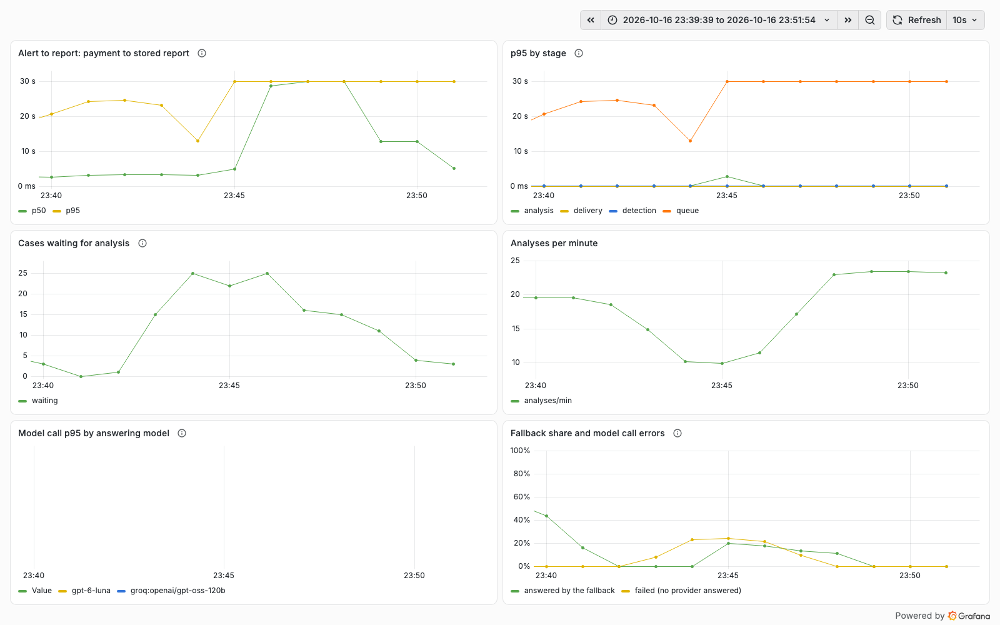
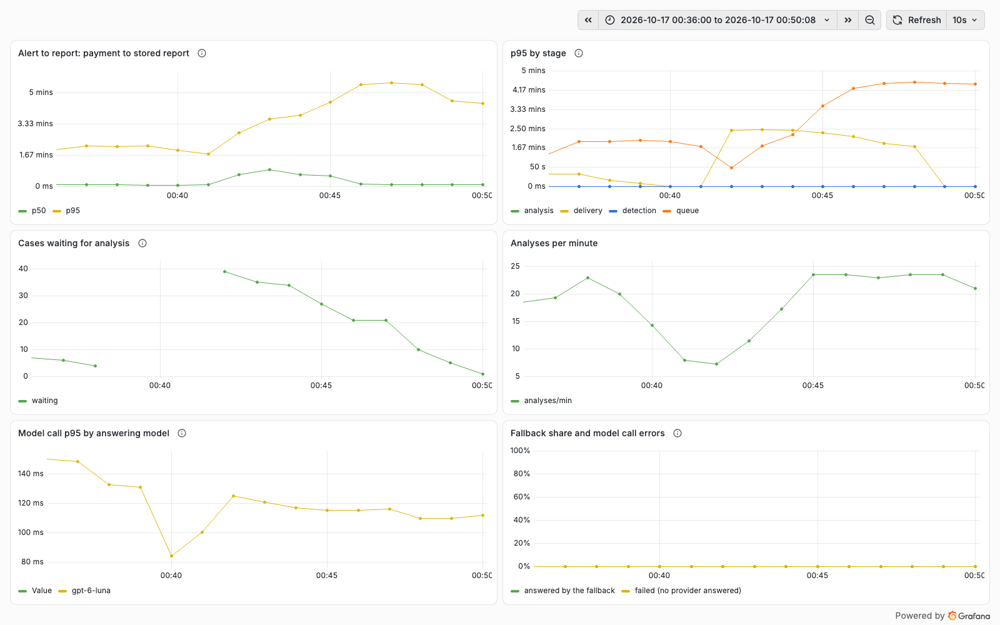
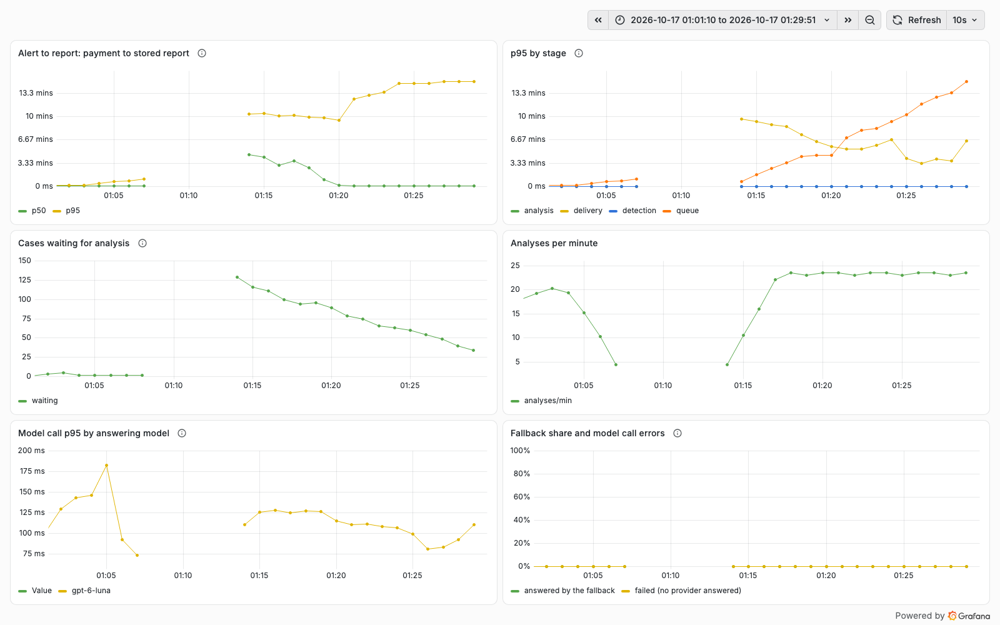
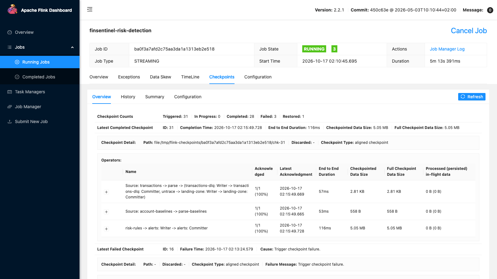

# Phase 9C chaos drills, 2026-10-16/17

Decision record: [ADR 0026](../adr/0026-chaos-drills.md). Same laptop and stack as phase 9B
([results](2026-10-16-phase-9b.md)): Docker Desktop with Kafka, Postgres, Redis, Keycloak, Apicurio, WireMock and
Grafana LGTM; the platform (profile `load`), both MCP servers and fake-llm as local JVMs; Flink embedded (drills 0-11)
or as the compose `stream` cluster (drill 12). Nothing called a paid model.

## Method

Steady traffic for every drill: `scripts/stack.sh traffic --tps=20 --fraud-every=3` (about 20 alerts a minute on
1,000 accounts). `scripts/perf/drill.py` runs one drill: 90 s of baseline, the fault (`--inject`), held for a fixed
time, the repair (`--heal`), then samples until everything that was up is up again, a report has been stored since the
repair and the backlog is back to its baseline (plus 2 cases of normal wobble), and 60 s more. Every 5 s it records the
backlog, alerts, analyses and FAILED cases (Postgres), the end offsets of every topic (Kafka), the health of each
process and the Flink job's state, restarts and checkpoints. Each drill's folder under [`9c/`](9c/) holds
`summary.md`, `summary.json`, `samples.csv`, `chart.svg`, the platform's warnings in the window and screenshots of the
Grafana dashboard (and of the Flink UI for the Flink drills), taken at the end of the drill because Grafana keeps its
series only while its container lives.

What "lost" means here, and how it is counted exactly rather than from rates:

- **Transactions**: records on `txn.transactions.v2` whose Kafka timestamp falls in the drill window (Kafka's time
  index), minus the malformed ones the simulator sent, against rows stored with a send time in the same window. A
  GEO_JUMP's home payment is sent 20 minutes after its event time, which the count allows for. Tolerance: +-3 (window
  edges).
- **Alerts**: records on `risk.alerts.v2` against rows stored, by detection time; a difference is a duplicate (same
  deterministic id, stored once, ADR 0003) or a dead letter (checked on `risk.alerts.v2.DLT`).
- **Detection**: every scenario the simulator logged, against an alert of the matching rule on that account. A
  GEO_JUMP between land neighbours (Malaysia-Thailand) raises nothing by design and is counted apart.
- **Payment to report**: from the alert's last payment to the first report stored after the alert arrived, per alert,
  split by when the alert arrived (before the fault, during it, after the repair).

Two things in the setup shape every recovery time below. The worker claims 2 cases, waits for both, then sleeps 5 s:
about 20-24 analyses a minute against about 20 alerts a minute of drill traffic, so the queue runs near 90% busy and
drains at only 2-4 cases a minute after any stall. And fake-llm answers in milliseconds, so the times describe the
platform, not a model.

## Results

| # | Fault | Held | Lost in the platform | Dead letters | FAILED cases | Backlog peak | Back to normal after the repair |
|---|---|---|---|---|---|---|---|
| 0 | none (control) | - | 0 | 0 | 0 | 5 | - |
| 1 | main model: every call 503 | 120 s | 0 | 0 | 0 | 5 | 5 s; main model answering again 11 s after |
| 2 | main and fallback model: every call 503 | 120 s | 0 | 0 | **7** | 28 | 325 s |
| 3 | main model 5 s slower per call | 120 s | 0 | 0 | 0 | 29 | 391 s |
| 4 | mcp-banking killed, restarted | 120 s | 0 | 0 | 0 | 6 | 10 s |
| 5 | CRM and core banking (WireMock) +10 s per response | 120 s | 0 | 0 | 0 | 18 | 120 s |
| 6 | Redis stopped | 120 s | 0 | 0 | 0 | 6 | 10 s |
| 7a | Postgres stopped | 30 s | 0 | 0 | 0 | 18 | not measured (the drill ended early: a script bug, since fixed) |
| 7b | Postgres stopped | 150 s | **1 alert, 1 transaction** | **2** | 0 | 45 | 420 s |
| 8 | Kafka stopped | 60 s | 0 (the simulator lost 2 sends) | 0 | 0 | 6 | 13 s |
| 9 | schema registry stopped (caches warm) | 120 s | 0 | 0 | 0 | 4 | 9 s |
| 9b | registry stopped, platform restarted meanwhile | 249 s | 0 | 0 | 0 | 134 | **platform down until restarted by hand** (9 min); backlog not drained within 20 min |
| 10 | platform `kill -9` mid-analysis, restarted at once | 21 s | 0 | 0 | 0 | 14 | 15 s; the 2 claimed cases **5 min** |
| 11 | embedded Flink `kill -9`, cold restart | 30 s | 0 | 0 | 0 | 7 | 25 s; **LARGE_AMOUNT 36/76 for 12 min** |
| 11b | as 11, batch baselines published | 30 s | 0 | 0 | 0 | 10 | 10 s; LARGE_AMOUNT 27/27 |
| 12 | Flink TaskManager killed (compose cluster) | 30 s | 0 (1 duplicate alert, stored once) | 0 | 0 | 21 | 10 s; job restored from checkpoint 13 |

Across all drills: 1,301 fraud scenarios, every one detected except drill 11's large amounts; no transaction lost
inside the platform except the one of drill 7b.

### 1-3. The model

Main provider down (1): the gateway's circuit opened after 3 failures; in 120 s the main model was tried 5 times (once
a minute after that) and the fallback answered 86 calls. Payment to report p95 15 s during the outage, 20 s after;
nothing failed. Both providers down (2): each case was tried 3 times on consecutive polls, 8-10 s apart, then marked
FAILED: 7 cases, which stay FAILED after the outage until a new alert or an analyst reopens them. The backlog then
took 325 s to drain. (Fixed since: attempts now wait a growing pause, [fixes](2026-10-18-9c-fixes.md).) A slow model (3) never falls back (the gateway falls back on errors only): every analysis took
15.1 s instead of 0.06 s (three calls of 5 s), 12 analyses in the 120 s, the backlog reached 29 and payment to report p95 was 252 s for alerts that arrived during the slow
period.

### 4-5. Outside systems

mcp-banking killed (4): all 42 CRM calls during the outage returned `Unavailable` in about 24 ms (connection refused),
reports say which check was missing, nothing failed, latency did not move; the platform's MCP client reconnected by
itself (2 empty calls in the seconds after the restart). The same systems slow instead (5) cost more: every CRM call
waited the full 5 s read timeout of mcp-banking before it gave up (p95 5,152 ms), so throughput fell, the backlog rose
to 18 and payment to report p95 to 160 s. The platform has a circuit breaker for models but not for outside systems.
(Fixed since: a breaker per system, [fixes](2026-10-18-9c-fixes.md).)

### 6. Redis

Stopped for 120 s: search-cache errors count as misses, Lettuce reconnected after the restart, nothing failed. The
p95 of alerts during the outage rose from 7 s to 25 s.

### 7. Postgres

30 s (7a) was absorbed: each Kafka listener attempt waits up to 30 s for a connection (Hikari's default), so the first
attempt simply succeeded once Postgres was back. At 150 s (7b) the listeners' three attempts (two retries, 1 s apart,
each waiting 30 s) ran out and the error handler dead-lettered what it held: one alert, whose dead letter carries
`Could not open JDBC Connection for transaction` (the first record ever on `risk.alerts.v2.DLT`), and one transaction.
Neither is replayed by anything, so that alert is never analysed. The rule that only an unreadable message may be
dead-lettered (ADR 0018) is kept for the Avro decoding but not for the listener as a whole: any exception is retried
twice and then parked. The backlog peaked at 45 and drained in 420 s. (Fixed since, and the drill repeated with
nothing dead-lettered: [fixes](2026-10-18-9c-fixes.md).)

### 8-9. Kafka and the schema registry

Kafka stopped for 60 s (8): nothing lost or failed inside the platform; Flink logged failed offset commits and carried
on without a restart; the outbox and listeners reconnected. The simulator, standing in for the bank's core system,
blocked for 60 s waiting for metadata and then dropped 2 sends: a producer outside the platform's boundary. Apicurio
accepted writes after the restart (the hang ADR 0024 found followed a container recreate, not a restart).

Registry stopped with warm caches (9): no effect at all; both the Flink job and the platform had every schema cached.
Stopped while the platform restarted (9b): the platform could not start. `alertSerde` resolves its schema when the bean
is created, the context fails and the process exits, so the analyst API and the MCP server went down with the intake.
Nothing restarts a local process; it was restarted by hand 9 minutes later (an orchestrator would have restarted it in
a loop until the registry answered). Kafka kept every message: nothing was lost or dead-lettered, but 134 cases
queued, and at 2-4 cases a minute of spare capacity they were not drained within the drill's 20 minutes. (Fixed
since: the platform starts without the registry, [fixes](2026-10-18-9c-fixes.md).)

### 10. A platform instance killed mid-analysis

fake-llm was slowed to 1.5 s a call so that analyses were in flight, then the platform was killed with `kill -9` and
restarted at once (up in about 15 s). The two cases it had claimed at 17:34:25 were analysed at 17:39:27: the claim
timeout of 5 minutes, to the second, although the instance was back after 15 s. Both resumed from their checkpoints
(100 ms each), no duplicate report, nothing failed. Nothing tells a restarted or surviving instance that a claim's
owner has died; the claim simply times out ([details](9c/10-platform-kill/claimed-cases-after.txt)). (Fixed since:
claims are renewed and lapse after 30 s, [fixes](2026-10-18-9c-fixes.md).)

### 11-12. Flink

The embedded job killed with `kill -9` and started again (11), as `scripts/stack.sh flink` does, from nothing: the
Flink UI shows `Restored: 0`. Kafka offsets were committed with the checkpoints, so no transaction was skipped, but the
keyed rule state was gone. Bursts and geo jumps need only seconds or minutes of state and were all detected; large
amounts need an account's history, and with no batch baselines in this environment the rule had none:

| Minutes after the restart | 0 | 1 | 2 | 3 | 4 | 5 | 6 | 7 | 8 | 9 | 10 | 11 | 12 | 13 |
|---|---|---|---|---|---|---|---|---|---|---|---|---|---|---|
| LARGE_AMOUNT detected | 0/3 | 0/3 | 0/6 | 0/8 | 1/3 | 2/8 | 1/4 | 1/3 | 6/9 | 4/5 | 6/8 | 3/4 | 5/5 | 7/7 |

After running the batch job (`--as-of=2026-10-16`, 40,000 baselines published) and repeating the drill (11b), every
large amount after the restart was detected, 27 of 27, each alert naming its source ("batch baseline as of
2026-10-16"): the fallback of ADR 0019 doubles as a recovery path for lost stream state.

On the compose cluster (12) a TaskManager killed with `docker kill` is what a production failure looks like. The
JobManager declared it unreachable after 34 s of missed heartbeats, the job restarted once and restored checkpoint 13
(`Restored: 1`), and detection carried on: 38 of 38 scenarios, no transaction lost, one alert sent twice from the
replayed seconds and stored once. Two things in the compose setup surfaced on the way: `flink run` fails against the
cluster unless `--local.web-ui-port=8081` is passed (the job sets the REST port for its embedded mode), and each
container keeps checkpoints in its own `/tmp`, which restores only because the one TaskManager came back as the same
container.

## Findings, by consequence

1. **A Postgres outage longer than about 90 s dead-letters alerts and transactions** (7b). Fix: retry infrastructure
   errors without a limit (with backoff, listener paused) and dead-letter only `InvalidMessageException`; test with a
   database that goes away for longer than the retries. Fixed 2026-10-18, drill repeated with nothing dead-lettered:
   [fixes](2026-10-18-9c-fixes.md).
2. **The platform cannot start while the registry is down** (9b), and takes the analyst API and MCP server with it.
   Fix: resolve the writer schema lazily (first use) so the process starts and the listeners retry. Fixed
   2026-10-19, drill repeated: [fixes](2026-10-18-9c-fixes.md).
3. **A model outage of about half a minute fails cases for good** (2): three attempts on consecutive polls, no
   backoff, no retry once the provider is back. Fix: back off between attempts (`next_attempt_at`) so attempts span minutes.
   Fixed 2026-10-19, drill repeated with no case FAILED: [fixes](2026-10-18-9c-fixes.md).
4. **A dead instance's claims wait the full claim timeout** (10). Fix: a heartbeat that renews claims of live runs
   and a short lease (for example 60 s), keeping fencing as it is. Fixed 2026-10-19 with a 30 s lease, drill
   repeated: [fixes](2026-10-18-9c-fixes.md).
5. **No circuit breaker for outside systems** (5): every call pays the 5 s timeout during an outage. Fix: a breaker per
   system in `ExternalSystems`, like the gateway's. Fixed 2026-10-19, drill repeated: [fixes](2026-10-18-9c-fixes.md).
6. **Queue capacity is the recovery bottleneck** (2, 3, 7b, 9b): 2 cases per round and a 5 s pause after the whole
   round. Same as the 9B follow-up: a pool of workers that claim as they free up.
7. **A cold Flink restart loses rule state** (11) where nothing restores it: production runs a cluster whose
   JobManager restores the latest checkpoint (12), and batch baselines cover large amounts (11b); the local script
   could restore the latest retained checkpoint.
8. A slow model never falls back (3): falling back on errors only is the design (ADR 0012); a latency budget would
   need its own measurement. The compose `stream` profile needs the two fixes noted under 12.

Fixed during the drills: the dashboard's latency panels stopped at 30 s (Micrometer's default histogram range) and the
model-call p95 panel was empty (no histogram); both now come from `management.metrics.distribution` in
`application.yaml`, after drill 3. fake-llm never called an outside system's tool, so a first run of drill 4 tested
nothing; it now calls `getCustomerProfile` when offered, and drill 4 was repeated.
