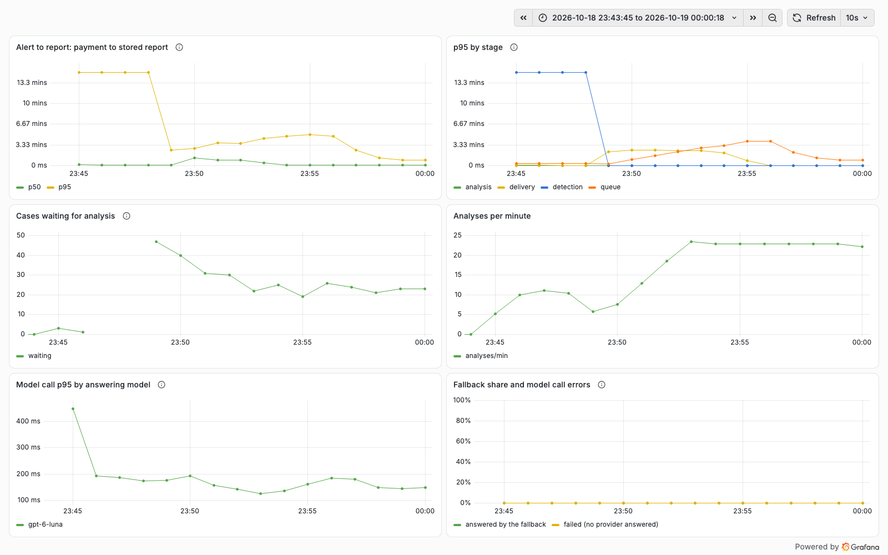
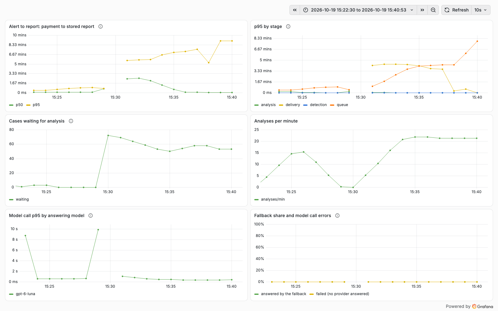
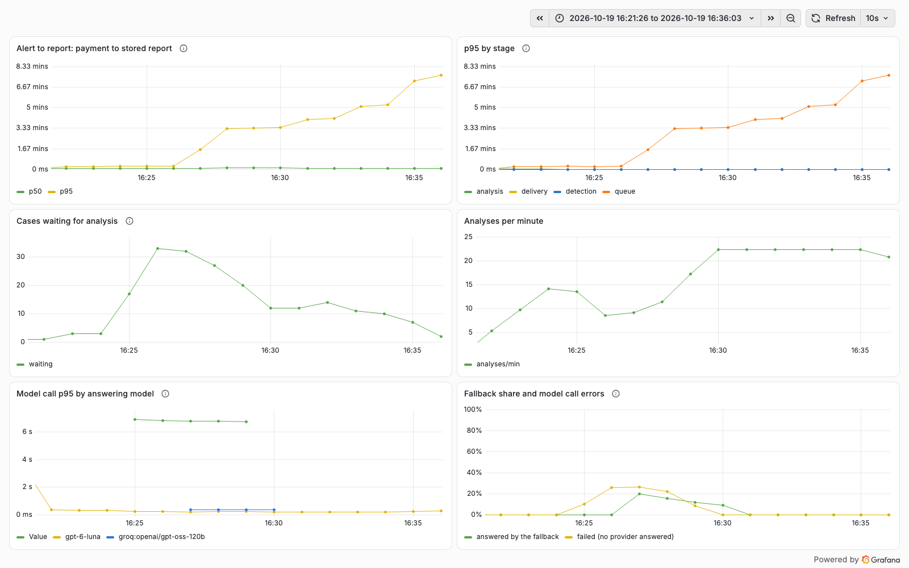
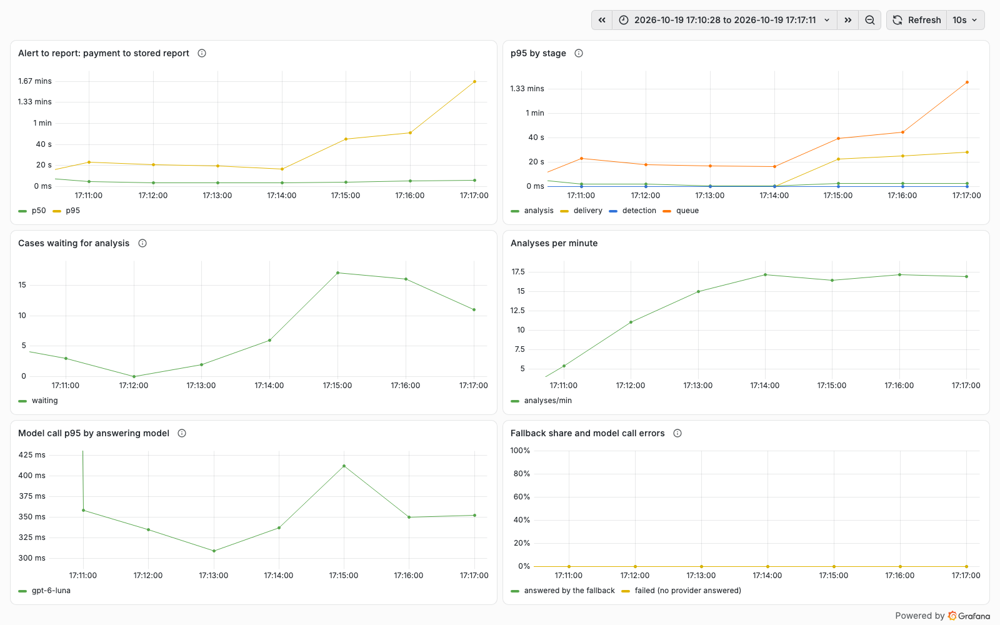
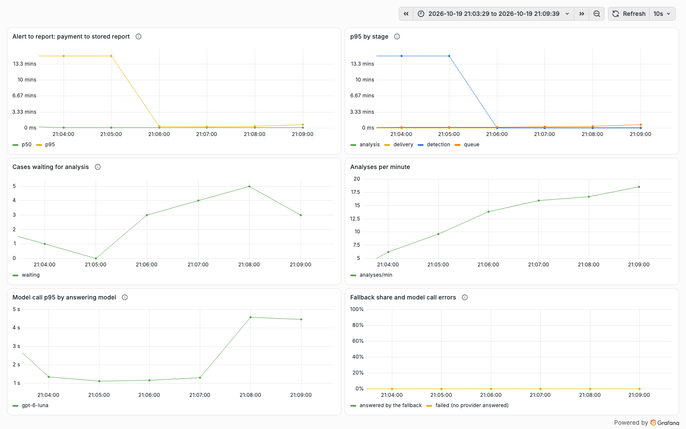
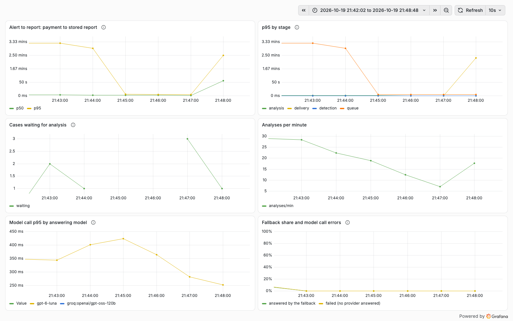
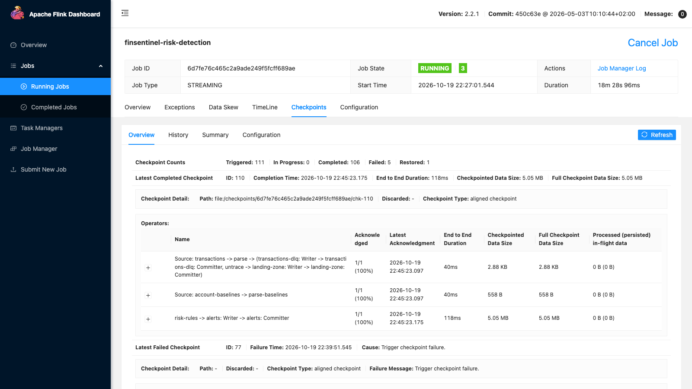

# Phase 9C findings fixed, drills repeated (from 2026-10-18)

The chaos drills of phase 9C ([results](2026-10-17-phase-9c.md), [ADR 0026](../adr/0026-chaos-drills.md)) ranked
seven findings and fixed none. Each fix here is proven twice: by a test that fails without it (checked by reverting
the fix on a clean build), and by repeating the drill that found it, on the same laptop and stack, with the same
traffic (`scripts/stack.sh traffic --tps=20 --fraud-every=3`) and the same `scripts/perf/drill.py` command. Data and
screenshots of each repeat are in [`9c/`](9c/), next to the original drill, with the suffix `-after-fix`.

| Fix | Drill | Before | After |
|---|---|---|---|
| 1. Never dead-letter on infrastructure errors | 07b, Postgres stopped 150 s | **1 alert and 1 transaction dead-lettered**, never analysed | 0 dead letters; 0 transactions missing (17,724 records, 65 malformed, 17,659 stored), 332 alert records, 332 stored |
| 2. Start without the schema registry | 9b, registry stopped ~250 s, platform restarted meanwhile | **Platform down 9 min** (until restarted by hand), first analysis 327 s after the registry returned | Platform down 14 s (its own restart), API up throughout the outage; first analysis 36 s after |
| 3. Back off between analysis attempts | 02, both models answering 503 for 120 s | **7 cases FAILED for good** (3 attempts 8-10 s apart) | 0 FAILED: 19 cases failed 1 or 2 attempts, all analysed after the outage; back to baseline in 509 s (before 325 s) |
| 4. Claim heartbeat, shorter lease | 10, platform `kill -9` mid-analysis, restarted at once | The 2 claimed cases analysed **5 min 2 s** after their claim (the claim timeout) | Taken over and analysed 33.7 s after their claim (the 30 s lease), resumed from checkpoints, no duplicate report |
| 5. Circuit breaker per outside system | 05, CRM and core banking 10 s slow for 120 s | Every CRM call waited out the 5 s timeout; backlog 18, back to baseline **120 s** after the repair | 29 of 37 CRM calls failed at once (circuit open); backlog 7, back to baseline 5.5 s after |
| 6. Worker pool instead of batches | 03, 02 and 07b again | Back to baseline 391 s, 325 s and 420 s after the repair (7b and 02 slower still after fixes 1 and 3) | 13 s, 107 s and 11.5 s, at the same 2 analyses at once |
| 7. Flink restarts keep their state | 11, embedded job `kill -9`, restarted; 12, TaskManager killed on the compose cluster | 11: `Restored: 0`, **LARGE_AMOUNT 36/76** in the next 12 min; 12: restored only because the same container came back, `flink run` needed the cluster's port passed by hand | 11: `Restored: 1`, LARGE_AMOUNT 54/54 from the first minute; 12: a new TaskManager container restored from the shared volume, 79/79; `flink run` with no extra flag |

## 1. Never dead-letter on infrastructure errors

**Finding** (drill 07b): the listeners' error handler retried any exception twice, 1 s apart, then published the record
to the dead-letter topic. With Postgres gone, each attempt waited Hikari's 30 s for a connection, so an outage longer
than about 90 s parked whatever the listeners held at that moment: one alert and one transaction in the drill, and a
whole batch of transactions if one had been in hand. Nothing replays a dead-letter topic, so that alert was never
analysed. Spring Kafka's default classification also sent some exceptions (`ClassCastException`,
`MessageConversionException` and four more) to the dead-letter topic without any retry.

**Fix** (`KafkaErrorHandling`): an exponential backoff (1 s, doubling, at most 10 s: `finsentinel.alerts.retry-*`)
with no limit on attempts or elapsed time, and a classification in which only `AvroSerde.InvalidMessageException` skips
the retries. During a pause the listener container is paused (`ContainerPausingBackOffHandler`), not the consumer
thread put to sleep, so the consumer stays in its group however long the outage; the batch listener's retries pause the
consumer and keep polling the same way. A failure that never goes away (a bug) now stalls its partition instead of
parking the record: the lag is visible and the record is still there once the bug is fixed.

**Tests**: `ListenerDatabaseOutageTest` shuts the platform out of the real Postgres container (its role loses LOGIN,
its sessions are ended) for 10 s while an alert and a transaction arrive; the pool's connection wait is lowered to
0.5 s for the outage so the old handling gives up in about 4 s instead of 90. Before the fix the alert was never
stored (the test waits 60 s); after it both are stored and neither is on a dead-letter topic. With the backoff given
an attempt limit again, the test fails. `KafkaErrorHandlingTest` hands the handler 50 failed deliveries of the same
record for each of a database error, a registry error, `ClassCastException` and `MessageConversionException`: none is
given up; an unreadable message goes to the dead-letter topic at once. With Spring Kafka's default classification
back, it fails at the first `ClassCastException`.

**Drill 07b repeated** (2026-10-18 15:44-15:59 UTC, [data](9c/07b-postgres-down-150s-after-fix/)):

| | Before ([07b](9c/07b-postgres-down-150s/)) | After |
|---|---|---|
| Postgres stopped | 150.6 s | 150.8 s |
| `risk.alerts.v2.DLT` / transactions DLQ (beyond the malformed ones) | **+1 / +1** | 0 / 0 |
| Transactions missing (exact count by Kafka timestamp) | **1** of 14,650 readable | 0 of 17,659 |
| Alert records not stored | 1 | 0 |
| Fraud scenarios detected | 156/156 | 198/198 |
| What arrived during the outage, stored after the restart | - | 61 alerts and 3,140 transactions, all 5-7 s after `docker start` |
| Backlog peak | 45 | 49 |
| Back to the baseline backlog | 420 s | **not within 600 s** (see below) |

The listeners caught up within seconds of the restart: their next attempt found the database. The queue did not, and
that is finding 6, not this fix: the traffic produced 23.6 alerts a minute in this run (19 in the original drill),
against about 23 analyses a minute from the worker (2 cases a round, then a 5 s pause). The backlog fell from 49 to
22 in the first four minutes and then stayed between 20 and 26 while new alerts arrived as fast as they were
analysed. The worker pool (fix 6) is measured on this drill again.

## 2. Start without the schema registry

**Finding** (drill 9b): the registry was stopped and the platform restarted meanwhile. The platform's serdes looked up
their own schema's id when the beans were created, so the context failed and the process exited, taking the analyst
API and the MCP server down with the intake. Nothing restarts a local process; it stayed down until restarted by hand,
9 minutes later.

**Fix** (`AvroSerde.forReading`, `MessagingConfig`): the platform only consumes, and a consumer reads by the writer's
id in each message, so its own schema's id is needed only to write. A serde built with `forReading` asks the registry
nothing until its first write; the platform's serdes are built that way. Producers (the Flink job, the simulator, the
batch job) keep `forSubject`, which looks the id up at once and fails at startup when the schema is not registered.
While the registry is down the platform starts and serves its API; a listener whose message carries a writer id it has
not seen fails, and with fix 1 it retries until the registry answers.

**Tests**: `StartWithoutRegistryTest` starts a platform whose registry is a closed port (its own context and
containers; the registry container runs and holds the schemas), checks that it answers HTTP, sends an alert as the
stream job would, checks that nothing is filed for 5 s, then points the registry at the container and expects the
alert filed within 60 s. Before the fix the context failed to load with `schema registry http://localhost:1
unreachable`, the same error as the drill. `AvroSerdeTest` builds a `forReading` serde against a registry that cannot
answer, sees the first write fail, and round-trips once it answers. Reverting `MessagingConfig` to `forSubject` fails
the first test; making `forReading` look its id up at once fails the second.

**Drill 9b repeated** (2026-10-19 07:23-07:40 UTC, [data](9c/09b-registry-down-cold-platform-after-fix/)): the same
inject command (stop the registry, kill the platform, start it again) and repair. The hold was raised from 120 s to
235 s so the registry stays down as long as in the original drill: there, starting the platform took the first 120 s
of the outage (the start script waited that long before giving up).

| | Before ([9b](9c/09b-registry-down-cold-platform/)) | After |
|---|---|---|
| Registry stopped | 249 s | 262 s |
| Platform not answering health checks | **9 min 15 s** (until restarted by hand) | 14 s (kill and restart) |
| Platform start while the registry is down | failed (the context did not load) | 15.8 s |
| First analysis after the registry returned | **327 s** | 36 s |
| What arrived during the outage, stored after the registry returned | - | 4,910 transactions 34-42 s after `docker start`, the last waiting alert after 31 s (Apicurio's own start included) |
| Transactions missing / alert records not stored / dead letters | 0 / 0 / 0 | 0 / 0 / 0 (20,009 records, 76 malformed, 19,933 stored; 317 alerts) |
| Fraud scenarios detected | 368/368 | 224/224 |
| Backlog peak | 134 | 72 |
| Back to the baseline backlog | not within 20 min | **not within 600 s** |

The platform stayed up and the intake caught up within a minute of the registry's return; what remained is again
queue capacity (finding 6): about 21 analyses a minute against about 21 alerts a minute, so the backlog fell from 72 to
about 50 and stayed there.

## 3. Back off between analysis attempts

**Finding** (drill 02): with both model providers answering 503, each case was tried 3 times on consecutive polls,
8-10 s apart, and marked FAILED: 7 cases within a 120 s outage, which stayed FAILED after it until an analyst or a new
alert reopened them. Three attempts that close together protect against nothing an outage does.

**Fix** (`fraud_case.next_attempt_at`, migration V14, `CaseRepository.fail`, `claim`): a failed attempt sets the
earliest time of the next one, and the claim skips cases until then. The pause starts at 1 minute and doubles, at most
10 minutes (`finsentinel.investigation.retry.*`), so the three attempts of `max-attempts` span 3 minutes instead of
20 seconds. The number of attempts, and so the most a failing case can cost, is unchanged. Every path that ends or
restarts the count clears the pause (analysed, superseded, FAILED, an analyst's decision, a new alert on a closed or
decided case); a new alert while the case is still in analysis keeps it, since the dependency that failed is probably
still down.

**Tests**: `CaseWorkerTest.aFailedAttemptWaitsAGrowingPauseSoAnOutageOfMinutesDoesNotFailTheCase` fails an attempt and
expects the next poll to claim nothing, a pause of 1 minute, then 2 minutes after the second failure, and the case
analysed once the model answers. Before the fix the next poll claimed the case again. Removing the claim's
`next_attempt_at` condition fails it at the same place; a pause that does not grow fails it at the second. The tests
that fail an attempt on purpose (`failedAnalysisIsRetriedThenTheCaseFails`, `CaseAnalysisResumeTest`) skip the pause
with `CaseTestSupport.makeDue`.

**Drill 02 repeated** (2026-10-19 08:22-08:35 UTC, [data](9c/02-llm-all-down-after-fix/)): the same fake-llm
behaviour (both providers 503 for every call) for 120 s.

| | Before ([02](9c/02-llm-all-down/)) | After |
|---|---|---|
| Fault held | 120.0 s | 120.4 s |
| Cases FAILED | **7** | 0 |
| Failed attempts | 26 (7 cases used all 3) | 26: 12 cases failed once, 7 twice (about 70 s apart), none three times |
| Cases with a failed attempt, analysed after the outage | - | 19 of 19, from 5 s to 9 min after the repair |
| Backlog peak | 28 | 34 |
| Back to the baseline backlog | 325 s | **509 s** |
| Transactions missing / alert records not stored | 0 / 0 | 0 / 0 |
| Fraud scenarios detected | 123/123 | 164/164 |

The price is a slower drain: a case that failed waits up to 2 minutes after the outage before its next attempt, and the
queue (about 20 analyses a minute against about 20 alerts a minute, finding 6) has no spare capacity to catch up
quickly once it is due, so the backlog fell from 34 to 12 in 3.5 minutes and then took 4 more to reach its baseline.
Cases that waited for analysis are not lost work, cases that are FAILED are: they need an analyst. An outage longer
than about 3 minutes still fails cases; holding them longer means more attempts or longer pauses, a decision about how
long a case may wait unanalysed rather than about cost, left for when a real outage shows what is needed.

## 4. Claim heartbeat, shorter lease

**Finding** (drill 10): the platform was killed with `kill -9` while it analysed two cases and was back 15 s later,
but the two cases waited for the claim timeout, 5 minutes to the second: nothing tells another instance that a
claim's owner has died. The timeout has to be longer than the slowest analysis, so it could not simply be shortened.

**Fix** (`fraud_case.claim_renewed_at`, migration V15, `CaseWorker`, `CaseRepository.renew`): while its analyses run,
the worker renews their claims every 10 s (`claim-heartbeat`); a claim not renewed for 30 s (`claim-lease`) has lapsed
and may be taken by any instance, as may one held longer than `claim-timeout` (5 minutes, unchanged: a run that is
alive but stuck still loses its claim). Fencing is as it was: `claimed_at` is the token, a renewal never changes it and
only renews a claim whose token still matches, and a worker whose claim was taken can write neither checkpoints nor a
result. A renewal that fails (the database gone) is skipped and logged; the claim may then lapse and be taken over,
which fencing makes safe. The two claim methods without a lease argument, used by the evaluation harness and tests that
claim without a worker, treat the whole claim timeout as the lease, since nothing renews their claims.

**Tests** (`CaseWorkerTest`): a case claimed 40 s ago by an instance that never renewed it is taken by the next poll
(before the fix: nothing claimed, the claim timeout had 4 minutes to go); a case claimed 40 s ago but renewed just now is
left alone; with a 1 s lease and a 200 ms heartbeat, a run held open for 3 s keeps its claim while a second worker polls
it continuously, and the case is analysed once. Reverting the claim condition to the timeout alone fails the first;
dropping the renewal fails the third (the second worker takes the case over). Along the way the concurrency test of the
hourly budget caught a mistake: the lease-less `claimWithinBudget` called the transactional one from inside the class,
past Spring's proxy, so the advisory lock no longer covered check and claim (24 claims against a budget of 10); it is
transactional itself now.

**Drill 10 repeated** (2026-10-19 09:11-09:16 UTC, [data](9c/10-platform-kill-after-fix/)): the same script (fake-llm
slowed to 1.5 s a call, `kill -9` with analyses in flight, restart at once).

| | Before ([10](9c/10-platform-kill/)) | After |
|---|---|---|
| Cases claimed at the kill | 2, claimed 17:34:25 | 2, claimed 09:13:40.6, killed 09:13:43 |
| Analysed after the restart | 17:39:27, **5 min 2 s** after the claim | 09:14:14.3, 33.7 s after the claim, both resumed after their checkpoint |
| Reports per run | 1 | 1 ([events](9c/10-platform-kill-after-fix/claimed-cases-after.txt)) |
| Platform back after the kill | about 15 s | 13 s, first analysis 19.5 s after the restart command |
| Transactions missing / alerts not stored / FAILED | 0 / 0 / 0 | 0 / 0 / 0 |
| Fraud scenarios detected | 27/27 | 48/48 |

The takeover came 30.7 s after the kill: the lease runs from the last renewal, which here was the claim itself 3 s
before the kill. A worse case is a kill just before a renewal is due, up to 30 s plus one poll after the last one. The
lease is a trade between that wait and how long a live instance may stall (a GC pause, a slow database) before its
claims are taken: three missed heartbeats.

## 5. Circuit breaker per outside system

**Finding** (drill 05): with CRM and core banking answering 10 s late, every CRM call waited out mcp-banking's 5 s
backend timeout before it came back `Unavailable`, analysis after analysis. Throughput fell, the backlog rose to 18 and
payment to report p95 to 160 s. The platform had a circuit breaker for model providers (ADR 0012) but not for outside
systems.

**Fix** (`McpServerConnection`, `resilience.CircuitBreaker`): each outside system (one MCP connection: banking,
compliance) has its own breaker, the gateway's class moved to a package both use. After 3 failed calls in a row (no
answer, an error, an unreadable answer) the system's calls fail at once with `SystemUnavailableException`, which the
tools already turn into `Unavailable`, for 30 s (`finsentinel.systems.circuit.*`); then one call tries again, and a
success closes the circuit. Per instance and in memory, like the gateway's: it saves waiting, it guards no shared state.
A span of a call skipped this way carries `finsentinel.circuit_open`. One system failing does not affect the other.

**Test** (`McpServerConnectionTest`): a local HTTP server answers every request after 300 ms with a 503. Three calls
fail after reaching it; the next ten fail with "circuit open" in under 300 ms together and none reaches the server;
after the open period the next call reaches it again. With the breaker never told of failures (the old behaviour, every
call waits), the fourth call reaches the server and the test fails. The test needs the breaker in the connection's
constructor, so the old code itself does not compile against it; the mutation stands in for it. The breaker class
itself is covered by `LlmGatewayTest` as before.

**Drill 05 repeated** (2026-10-19 13:04-13:09 UTC, [data](9c/05-systems-slow-after-fix/)): the same WireMock delay of
10 s on every CRM and core-banking response, for 120 s.

| | Before ([05](9c/05-systems-slow/)) | After |
|---|---|---|
| CRM calls during the slow period | 24, all `Unavailable`, every one after about 5 s (p95 5,152 ms) | 37: 36 `Unavailable`, 29 of them at once (circuit open), 8 after about 5 s (3 to open it, then one trial each 30 s) |
| Time analyses spent waiting on the CRM | 111 s | 41 s |
| Payment to report, alerts during the slow period (p50 / p95) | 18.9 s / 159.9 s | 7.9 s / 42.3 s |
| Backlog peak | 18 | 7 |
| Back to the baseline backlog after the repair | 120 s | 5.5 s |
| Transactions missing / alert records not stored / FAILED | 0 / 0 / 0 | 1 (within the +-3 edge tolerance; the DLQ grew by the 18 malformed records sent, nothing else) / 0 / 0 |
| Fraud scenarios detected | 72/72 | 40/40 |

The p95 of the CRM calls still reads 5 s: the calls that open the circuit and the trial calls wait the full timeout,
and they are more than 5% of the calls. What changed is how many do. A shorter wait for the calls that still go out
would need a shorter backend timeout in mcp-banking, a trade against a CRM that is slow but answering.

## 6. Worker pool instead of batches

**Finding** (drills 2, 3, 7b and 9b; ADR 0025 Next): the worker claimed 2 cases, waited for both, then slept 5 s. That
gave 20-24 analyses a minute against about 20 alerts a minute of drill traffic, so after any stall the queue drained at
2-4 cases a minute; and one slow analysis held every slot of its round. The repeats of drills 07b, 9b and 02 above all
ended with the backlog flat above its baseline for this reason.

**Fix** (`CaseWorker`): a pool of `concurrency` slots (the setting `batch-size` renamed, still 2). A finished run
claims the next case at once; the poll (5 s) only matters when the slots fell idle. A scheduled heartbeat renews the
claims of all runs in flight (fix 4 renewed them while waiting for a batch, which no longer exists). Claiming stays one
transaction under the budget's advisory lock, sized to the free slots, so the budget and `SKIP LOCKED` hold as before;
the in-flight set is this instance's own runs. `runOnce()`, which the tests use to drive the queue, still claims for the
free slots and waits, without refilling. Two analyses at once on an instance is unchanged: what changed is the idle time
between them, so this does not raise model spend or calls in flight.

**Test** (`CaseWorkerTest.aSlowAnalysisDoesNotHoldUpTheCasesBehindIt`): five slots, one slow case (HIGH, claimed
first) and five quick ones; one poll. All five quick cases must be analysed while the slow one still runs. Before the
fix the fifth quick case stayed in ANALYSIS until the slow one finished; with a poll that does not refill, the same.

**Drills 03, 02 and 07b repeated** (2026-10-19 13:28-13:48 UTC, one after another under the same traffic, [03](9c/03-llm-slow-after-pool/),
[02](9c/02-llm-all-down-after-pool/), [07b](9c/07b-postgres-down-150s-after-pool/)):

| Drill | | First run (9C) | After the earlier fix | With the pool |
|---|---|---|---|---|
| 03, main model 5 s slower per call, 120 s | backlog peak | 29 | - | 24 |
| | back to baseline after the repair | 391 s | - | **13 s** |
| | payment to report, alerts during the fault (p50 / p95) | 92 s / 252 s | - | 25 s / 105 s |
| 02, both models 503, 120 s | cases FAILED | 7 | 0 (fix 3) | 0 |
| | backlog peak | 28 | 34 | 36 |
| | back to baseline after the repair | 325 s | 509 s | **107 s** |
| 07b, Postgres stopped 150 s | dead letters | 2 | 0 (fix 1) | 0 |
| | backlog peak | 45 | 49 | 40 |
| | back to baseline after the repair | 420 s | not within 600 s | **11.5 s** |
| | payment to report, alerts after the repair (p95) | 269 s | 299 s | 149 s |

Nothing was lost in any of the three (07b: the transactions DLQ grew by 20 against 21 malformed records sent; the
exact count was off by one at the window's edge). Drill 02 drains slower than the others because its failed cases wait
out their pause (fix 3) before they are tried again: 22 cases failed once and 13 twice, none three times. Drill 03 still
builds a backlog during the fault: two analyses of 15 s each keep up with 8 alerts a minute, not 20; the pool drains it
once the model is fast again, and more slots would cut the peak at the price of more model calls in flight. With a real
model (38 s an analysis, ADR 0025) two slots make 3 analyses a minute: measuring 8-16 against a provider's rate limits
is still open (it costs money; ADR 0025 Next).

## 7. Flink restarts keep their state

**Findings** (drills 11 and 12): the embedded job (`scripts/stack.sh flink`) killed and started again began from
nothing (`Restored: 0`): Kafka offsets were committed, so nothing was skipped, but the rules lost every account's
history, and large amounts went undetected until the history was rebuilt (36 of 76 in the next 12 minutes). On the
compose cluster the JobManager did restore after a TaskManager was killed, but only because that TaskManager came back
as the same container: each container kept checkpoints in its own file system. And `flink run` against the cluster
failed unless `--local.web-ui-port=8081` was passed, because the job set its embedded web UI port, and its checkpoint
directory, in every mode.

**Fix** (`RiskDetectionJob.environment`, `LatestCheckpoint`, `stream-job.properties`, `deploy/docker-compose.yml`):
the job tells the two modes apart (`LocalStreamEnvironment` is the embedded one).

- Embedded: the job sets the web UI port and the checkpoint directory as before, keeps its last checkpoint when it is
  stopped (`RETAIN_ON_CANCELLATION`; a `kill -9` keeps it anyway), and starts from the newest complete checkpoint under
  the directory (`checkpoint.restore=latest`, the default; `none` for a cold start, passed as
  `scripts/stack.sh flink --checkpoint.restore=none`). Each start has a new job id, so the newest `chk-*/_metadata`
  across all job directories is taken; a checkpoint still being written has no `_metadata` and is skipped.
- Cluster: the job leaves the REST port, checkpoint storage and restore to the cluster's configuration. In compose both
  Flink containers mount one volume at `/checkpoints` (`execution.checkpointing.dir`), handed to the image's flink user
  by a one-shot init container, so a TaskManager that comes back as a new container reads the same files.

**Tests** (`stream-job`): `EmbeddedRestartTest` runs a stand-in pipeline the way the embedded job runs (a checkpointed
number sequence; its position is restored like the rules' keyed state), cancels it after a checkpoint, and starts it
again: the second run must continue after the first run's position; with `checkpoint.restore=none` it starts from 1;
and in cluster mode the environment carries neither the REST port nor a checkpoint directory. `LatestCheckpointTest`
picks the newest complete checkpoint across job directories and skips incomplete ones and remote storage. Each part of
the fix reverted fails a test: no restore path (the second run starts at 1), no retention (the cancelled run's
checkpoint is deleted and the second run cannot start from it), cluster mode given the embedded settings. The tests
need the new methods, so the old code itself is shown failing by the drills, not by them.

**Drill 11 repeated** (2026-10-19 14:07-14:22 UTC, [data](9c/11-flink-process-kill-after-fix/)): the same `kill -9` and
`flink-start.sh` as the original, with batch baselines older than their 3-day limit (as in the original, none apply).

| | Before ([11](9c/11-flink-process-kill/)) | After |
|---|---|---|
| Restored on restart | 0 | 1 (`chk-155` of the killed run) |
| LARGE_AMOUNT detected in the 13 minutes after the restart | **36/76**, 0 in the first 4 minutes | 54/54, every minute ([per minute](9c/11-flink-process-kill-after-fix/detection-after-restart.txt)) |
| Where those alerts took the history from | - | streaming history, all 59 large-amount alerts ("71 transactions") |
| Fraud scenarios detected in the drill | 34/37 | 203/203 |
| Transactions missing / dead letters | 0 / 0 | 0 / 0; 2 alerts sent twice from the replayed seconds, stored once |

**Drill 12 repeated** (2026-10-19 14:37-14:45 UTC, [data](9c/12-flink-taskmanager-kill-after-fix/)): the job submitted
with `flink run` and no extra flag, 10 minutes of traffic, then the TaskManager killed and replaced by a new container
(`docker rm -f` and `docker compose up -d`) instead of restarted.

| | Before ([12](9c/12-flink-taskmanager-kill/)) | After |
|---|---|---|
| `flink run` against the cluster | failed without `--local.web-ui-port=8081` | works as documented in the compose file |
| TaskManager after the fault | the same container, started again | a new container |
| Restored | checkpoint 13, from the old container's own `/tmp` | checkpoint 73, `file:/checkpoints/...` on the shared volume |
| Fraud scenarios detected | 38/38 | 79/79; 42 large amounts after the restart, all from streaming history |
| Transactions missing / dead letters | 0 / 0, 1 duplicate alert stored once | 0 / 0, 3 duplicate alerts stored once |
| Back to the baseline backlog | 10 s | 19.9 s |

Restoring is still not free: a corrupt or incompatible checkpoint now stops the embedded job from starting until it is
run with `--checkpoint.restore=none`, and the checkpoint directories of earlier runs are kept (one complete checkpoint
each) until removed by hand.

